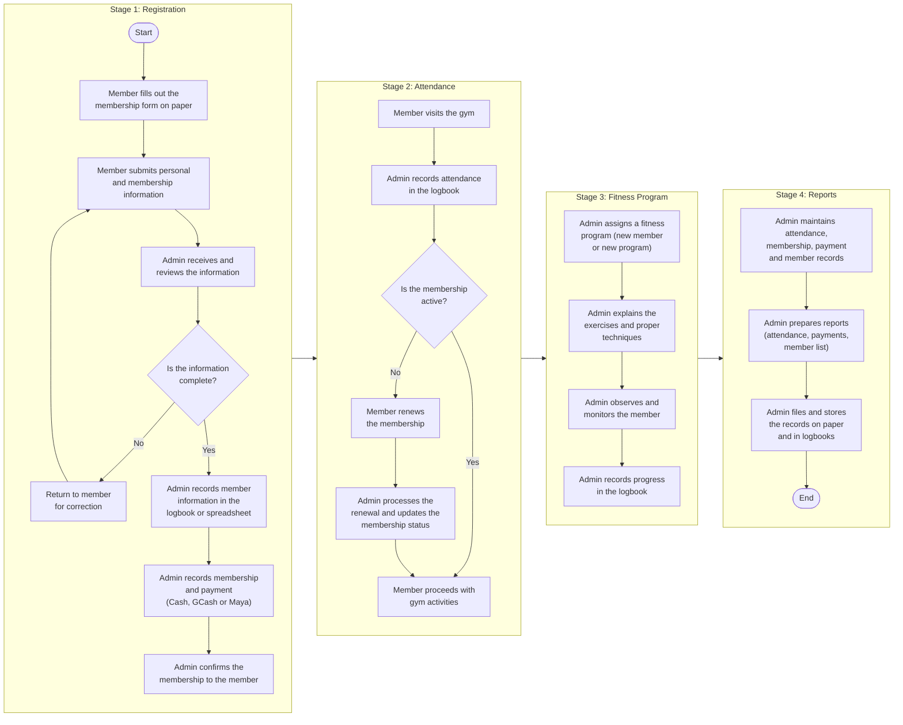
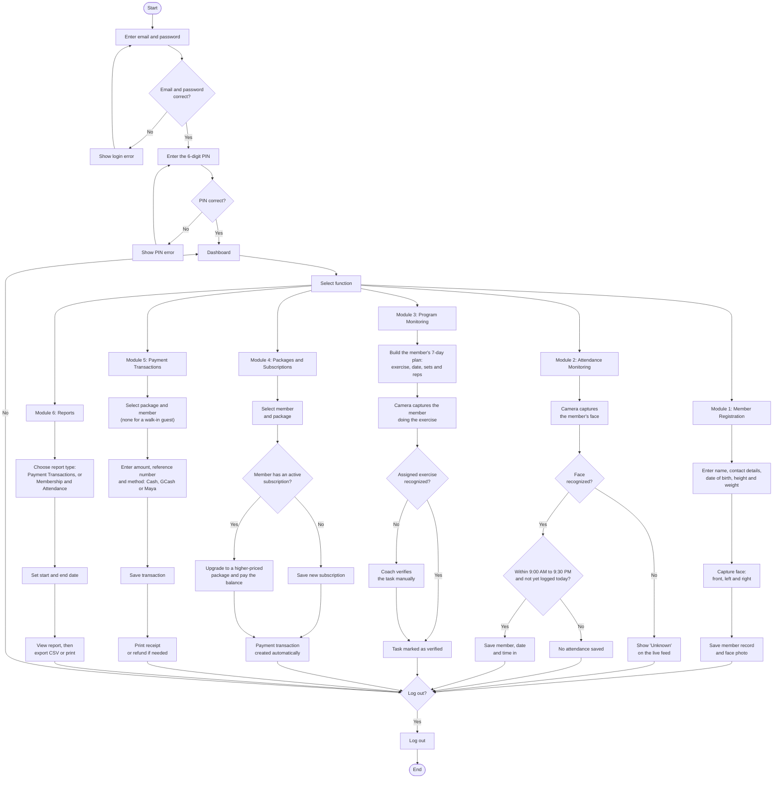
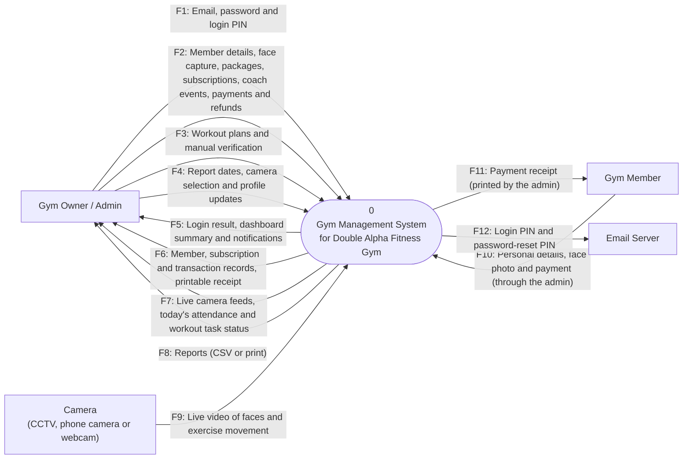
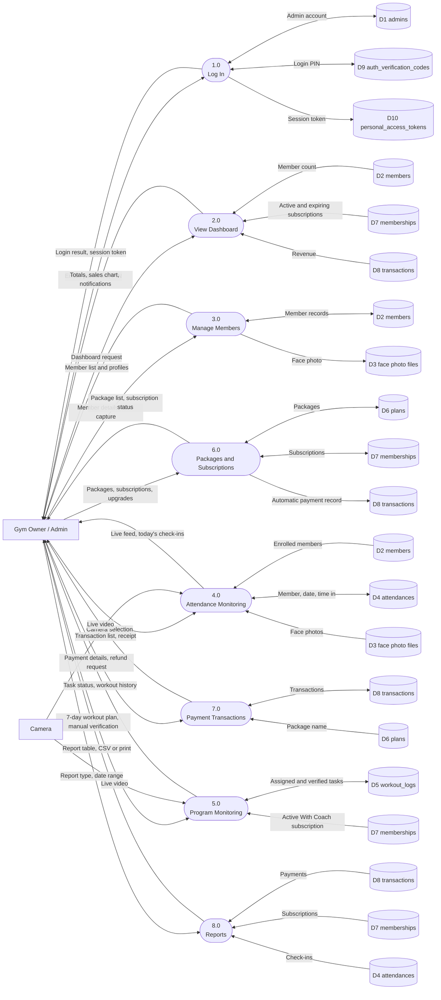
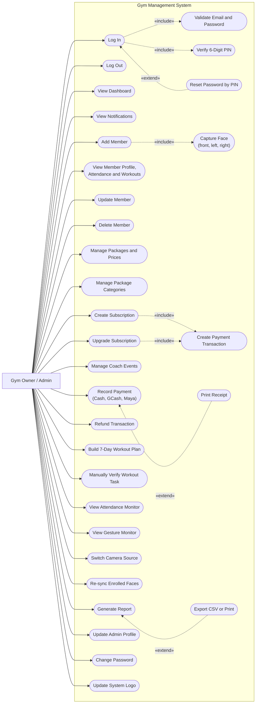
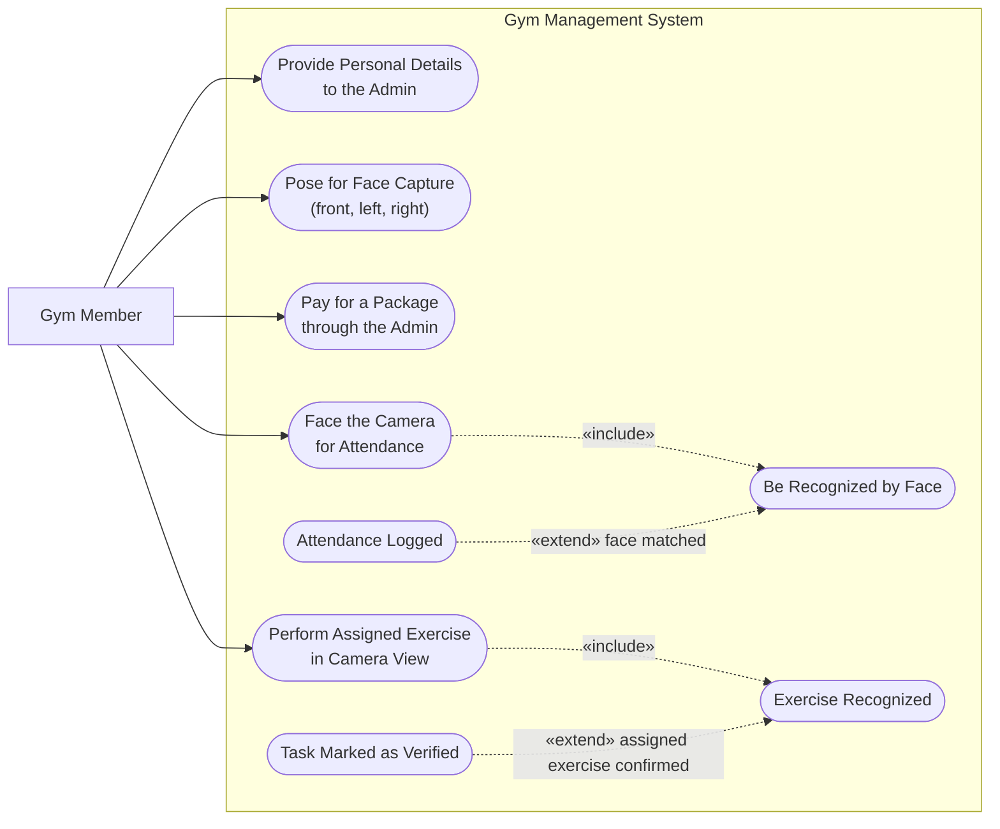
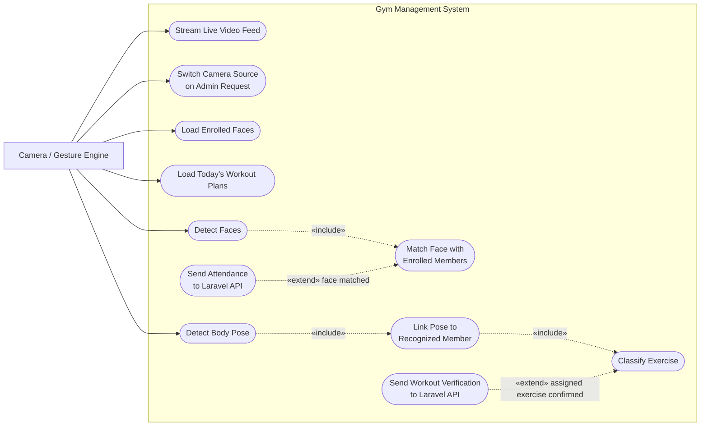
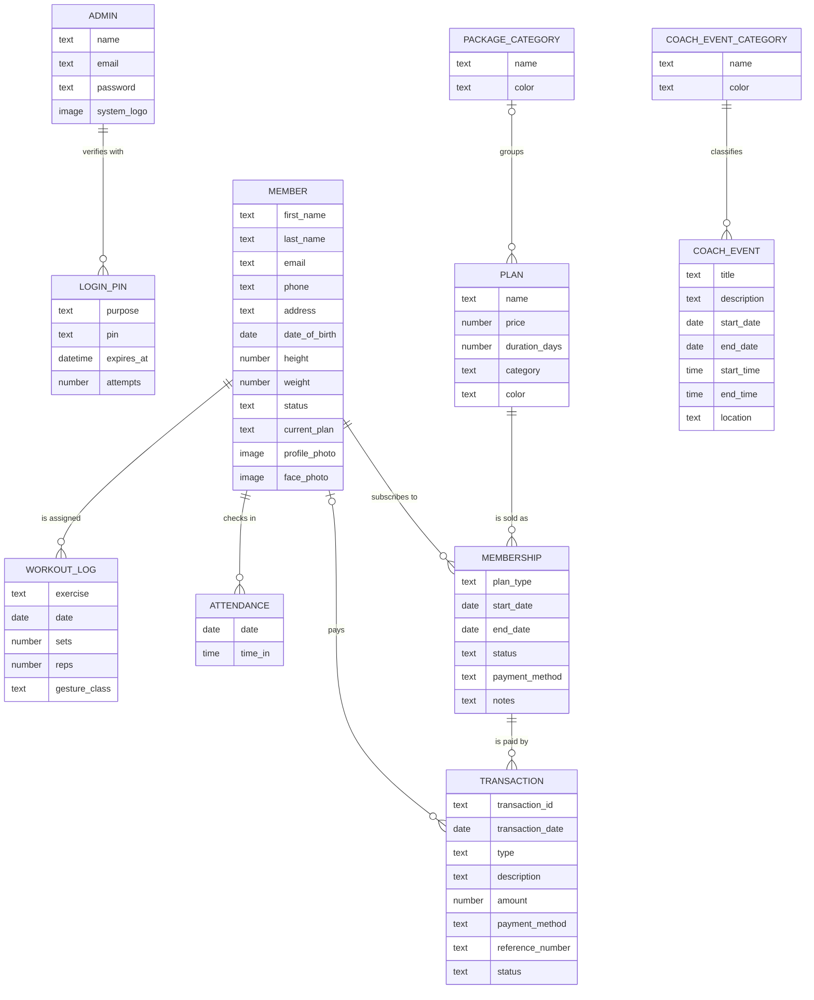
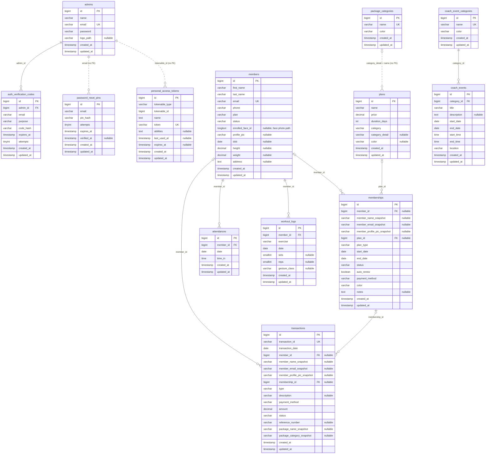

# Chapter 4 Diagrams — Double Alpha Fitness Gym Management System

One diagram for each figure in Chapter 4. Figure 4.1 shows the gym's manual process before the system. Figures 4.3 to 4.10 are drawn from what the system actually does. Diagrams only.

| Figure | Diagram |
|---|---|
| 4.1 | Manual Process Flow for Admin |
| 4.3 | System Process Flow for Administrator |
| 4.4 | Context Level Diagram |
| 4.5 | Data Flow Diagram |
| 4.6 | Use Case Diagram for Gym Owner / Admin |
| 4.7 | Use Case Diagram for Gym Member |
| 4.8 | Use Case Diagram for Camera / Gesture Engine |
| 4.9 | Logical Entity-Relationship Diagram |
| 4.10 | Physical Entity-Relationship Diagram |

---

## Figure 4.1 — Manual Process Flow for Admin

---

## Figure 4.3 — System Process Flow for Administrator

---

## Figure 4.4 — Context Level Diagram

---

## Figure 4.5 — Data Flow Diagram

---

## Figure 4.6 — Use Case Diagram for Gym Owner / Admin

---

## Figure 4.7 — Use Case Diagram for Gym Member

---

## Figure 4.8 — Use Case Diagram for Camera / Gesture Engine

---

## Figure 4.9 — Logical Entity-Relationship Diagram

---

## Figure 4.10 — Physical Entity-Relationship Diagram

Decimal sizes: `members.height` and `members.weight` are DECIMAL(5,2), `plans.price` is DECIMAL(9,2), `transactions.amount` is DECIMAL(10,2).

On delete: `attendances`, `workout_logs` and `auth_verification_codes` cascade; `memberships.member_id`, `transactions.member_id` and `transactions.membership_id` are set to null; `coach_events.category_id` is restricted.

Confirm on your database before finalizing: whether `memberships.plan_id` has a real foreign key (`SHOW CREATE TABLE memberships;`). It is drawn here as one.

Not drawn because the application does not use them: `face_encodings`, `payments`, `exercise_sessions`, `gesture_logs`, `exercises`, `users`, and Laravel's own tables (`sessions`, `cache`, `jobs` and similar).
