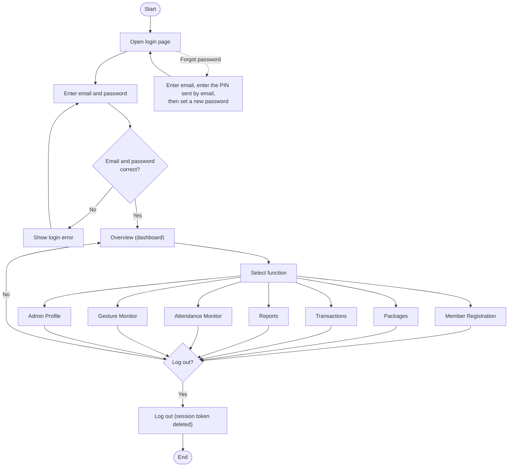
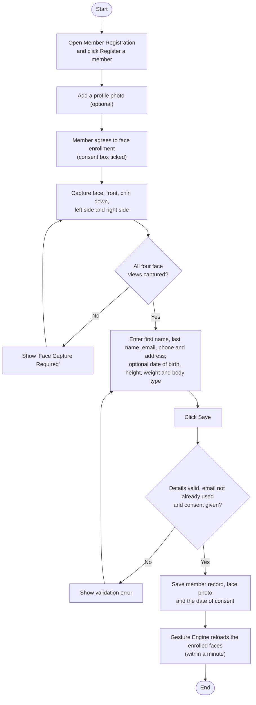
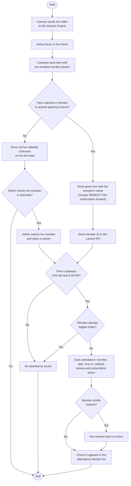
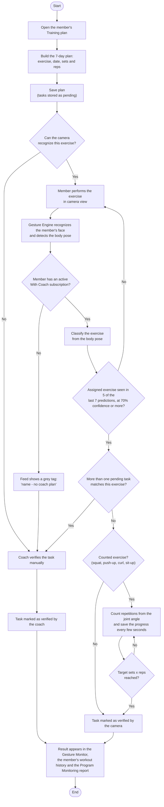
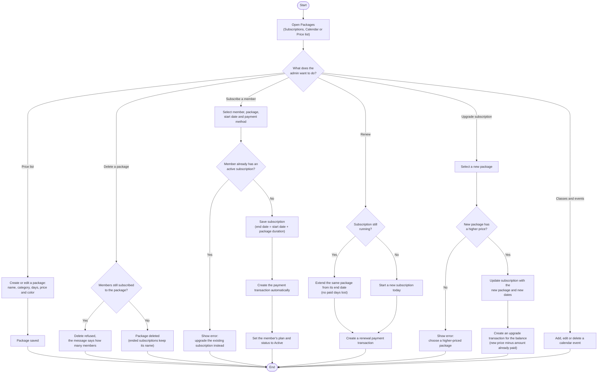
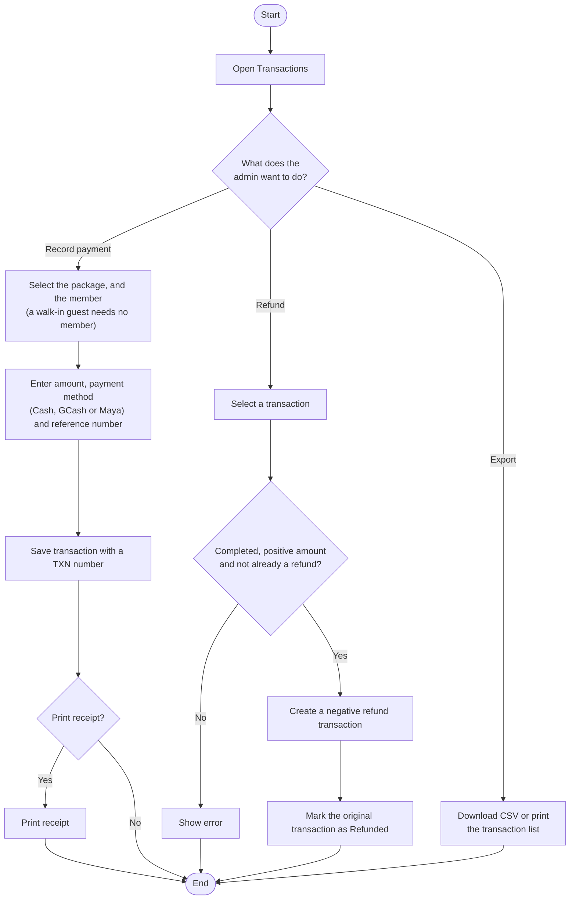
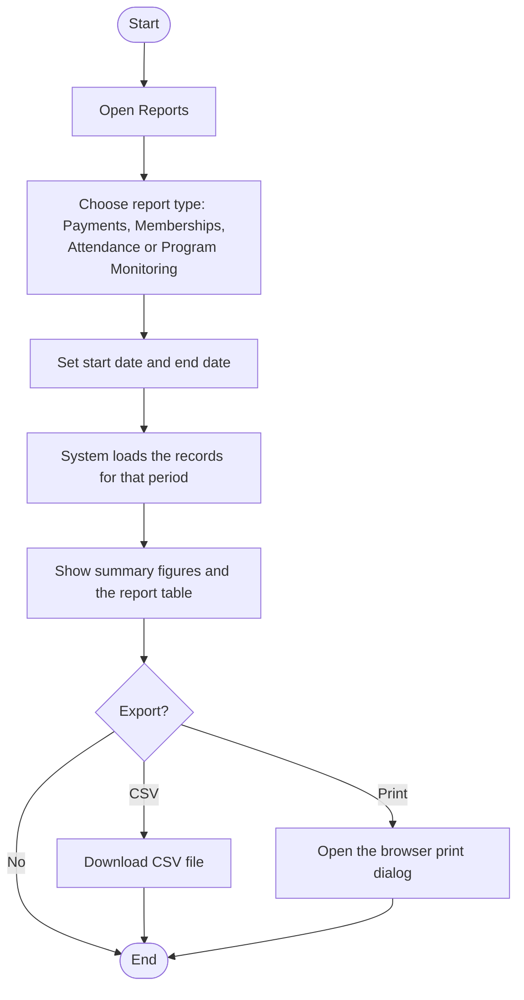

# 1. System Process Flow Diagram

[Back to the list of diagrams](../Correct_Diagrams.md)

> **Updated November 17, 2026** to match the system as built: no login PIN, body type and face consent at registration, manual check-in, repetition counting, renewals, the Price list, and four report types.

## 1.1 Login and navigation

## 1.2 Member registration

## 1.3 Attendance monitoring

## 1.4 Program monitoring

## 1.5 Packages and subscriptions

## 1.6 Payment transactions

## 1.7 Reports

