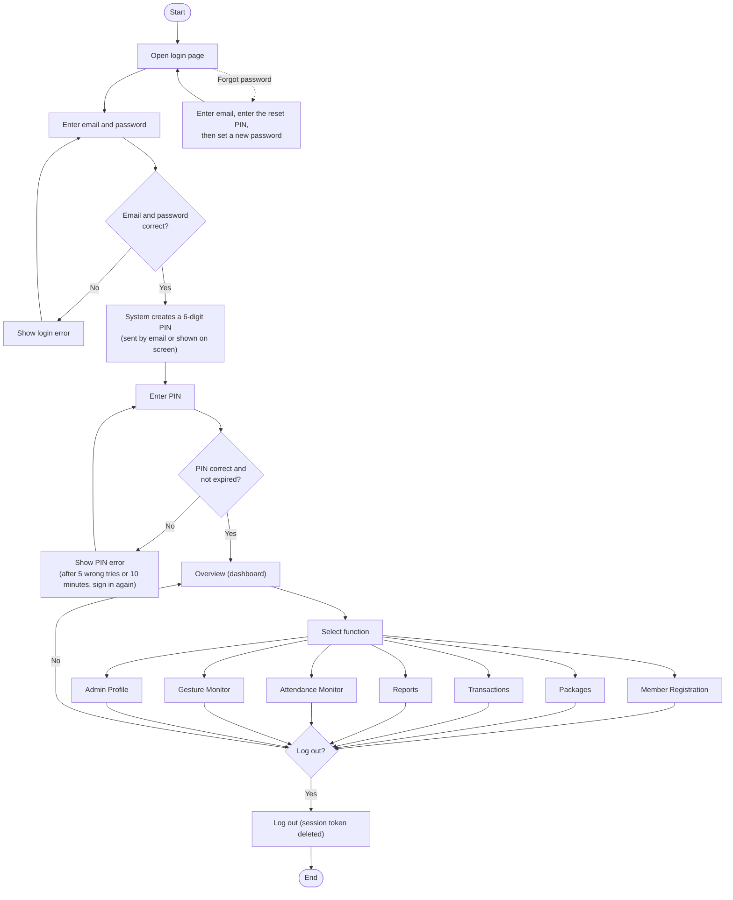
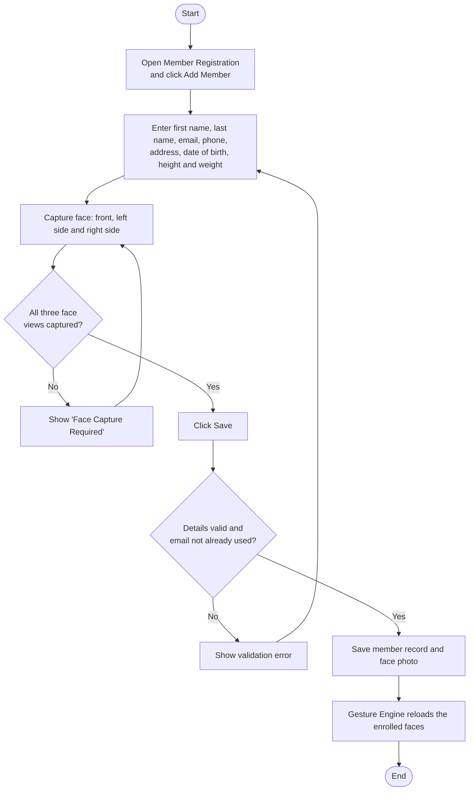
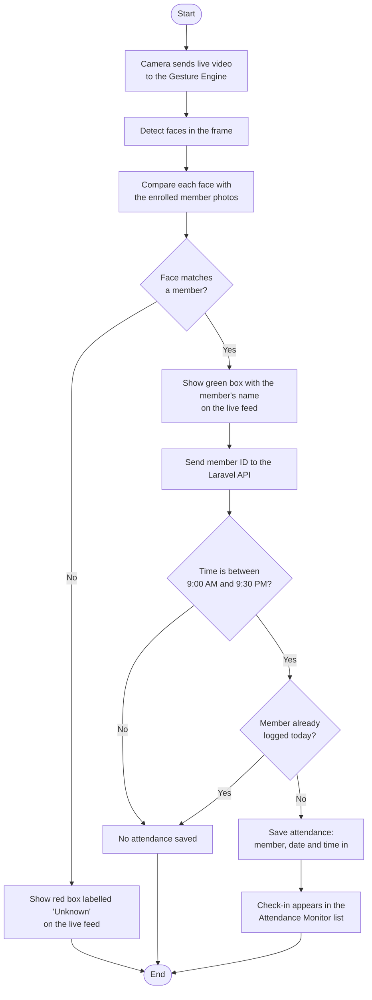
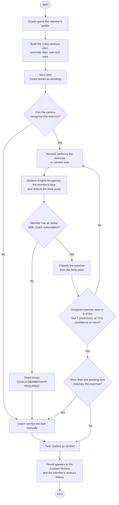
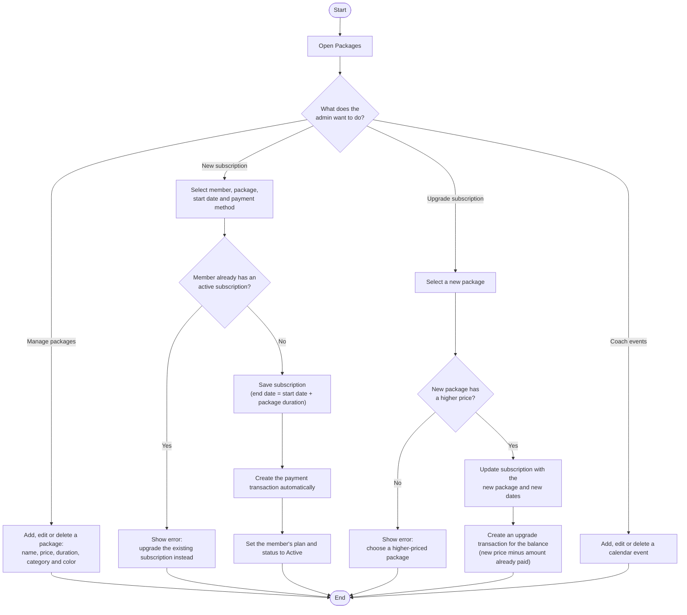
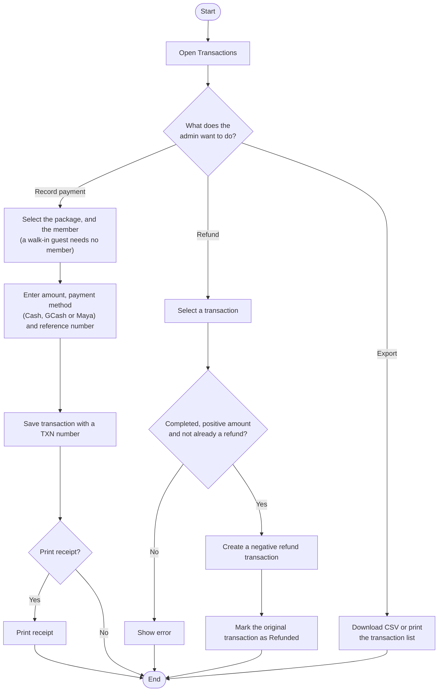
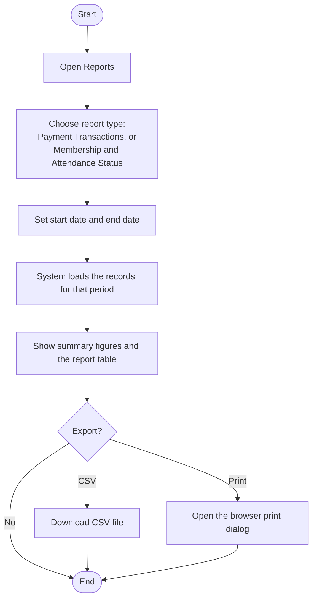

# 1. System Process Flow Diagram

[Back to the list of diagrams](../Correct_Diagrams.md)

## 1.1 Login and navigation

## 1.2 Member registration

## 1.3 Attendance monitoring (automatic)

## 1.4 Program monitoring

## 1.5 Packages and subscriptions

## 1.6 Payment transactions

## 1.7 Reports

