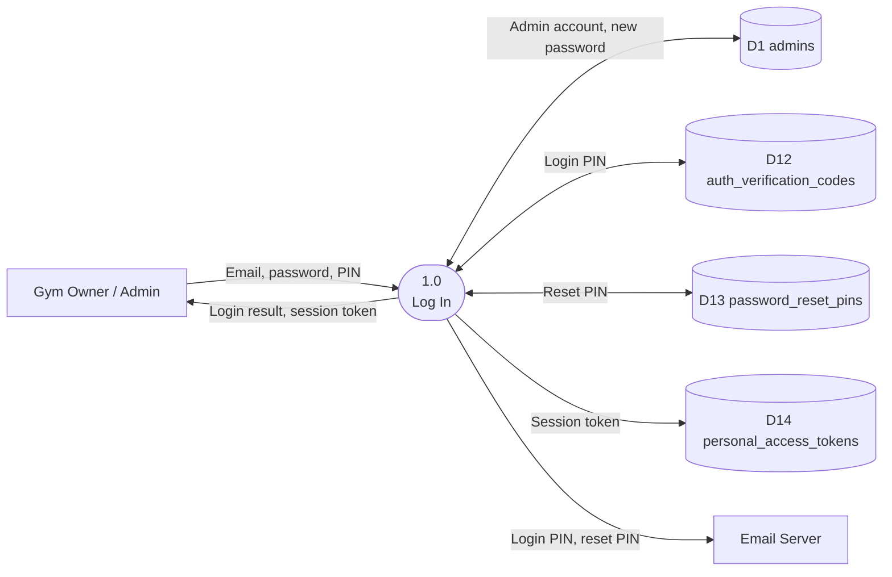
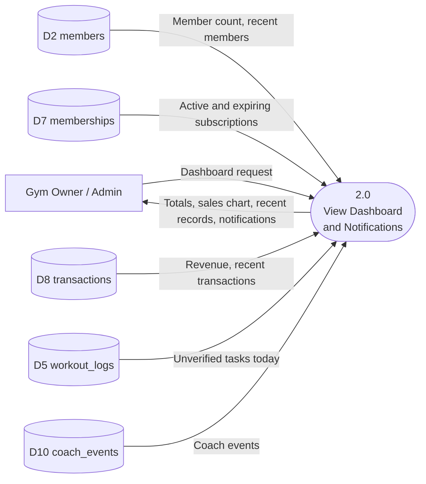
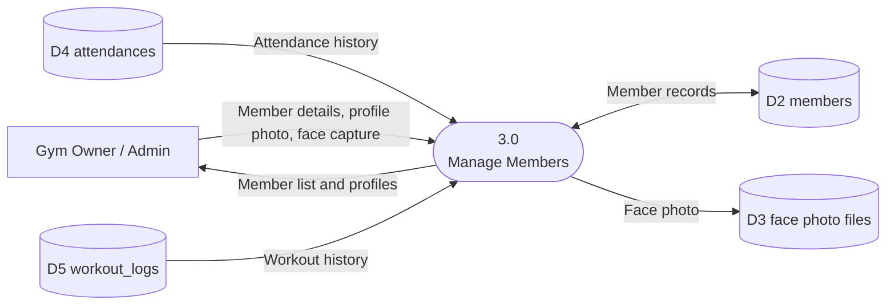
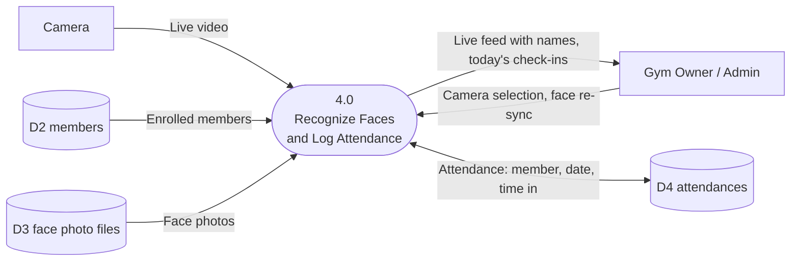
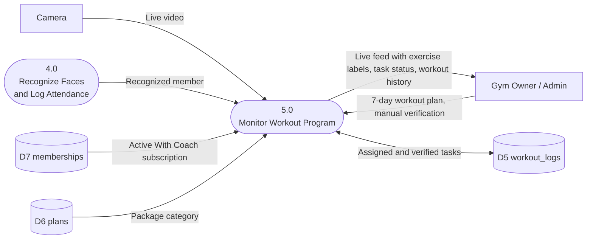

# 3. Data Flow Diagram Level 1 — Processes 1.0 to 5.0

[Back to the list of diagrams](../Correct_Diagrams.md)

The Level 1 DFD is drawn as one small figure per process so each one stays readable. Data store numbers (D1 to D14) are the same in every figure.

Processes 6.0 to 10.0 are in [the next file](3B_Data_Flow_Diagram_Processes_6_to_10.md).

## 3.1 Process 1.0 — Log In

## 3.2 Process 2.0 — View Dashboard and Notifications

## 3.3 Process 3.0 — Manage Members

## 3.4 Process 4.0 — Recognize Faces and Log Attendance

## 3.5 Process 5.0 — Monitor Workout Program

