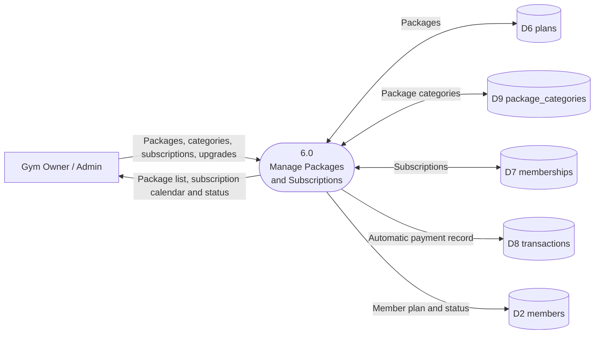
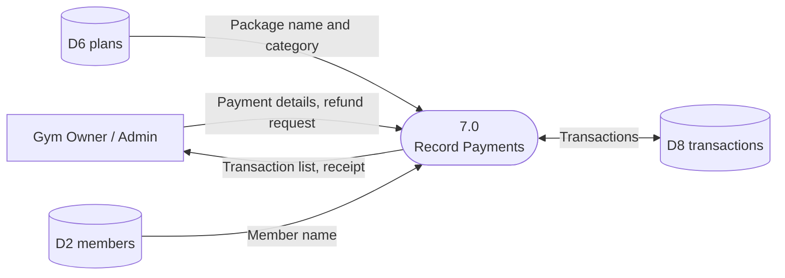
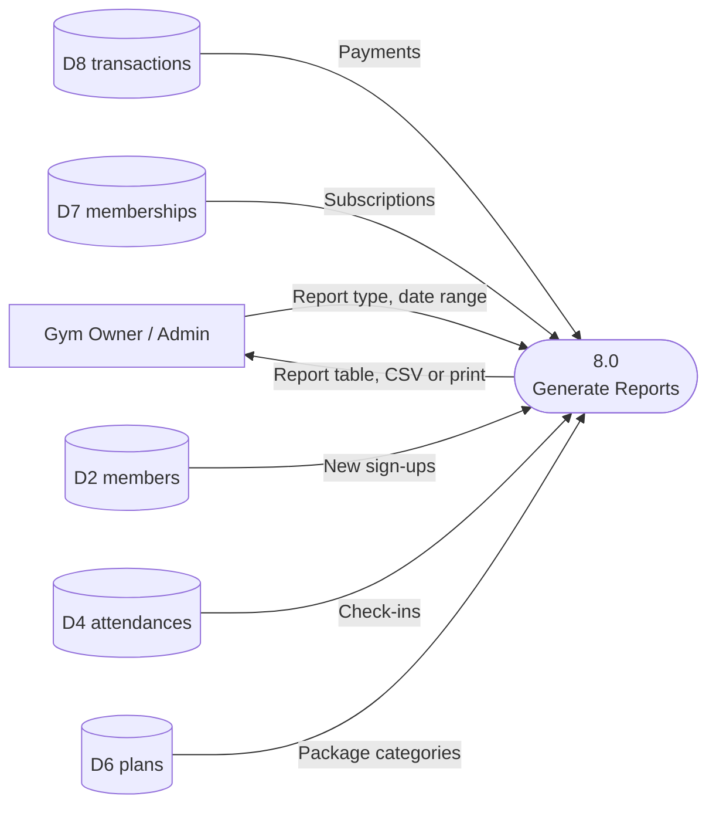
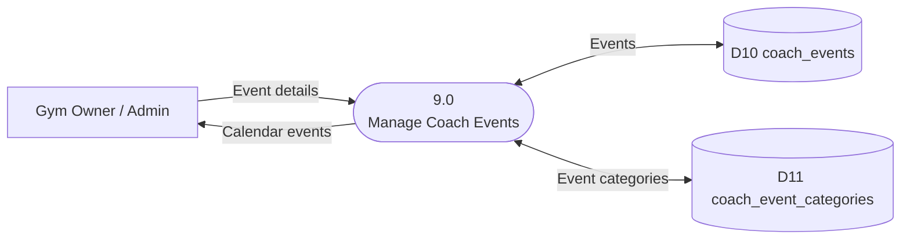
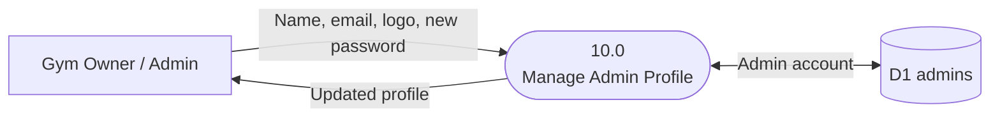

# 3. Data Flow Diagram Level 1 — Processes 6.0 to 10.0

[Back to the list of diagrams](../Correct_Diagrams.md)

The Level 1 DFD is drawn as one small figure per process so each one stays readable. Data store numbers (D1 to D14) are the same in every figure.

Processes 1.0 to 5.0 are in [the previous file](3A_Data_Flow_Diagram_Processes_1_to_5.md).

## 3.6 Process 6.0 — Manage Packages and Subscriptions

## 3.7 Process 7.0 — Record Payments

## 3.8 Process 8.0 — Generate Reports

## 3.9 Process 9.0 — Manage Coach Events

## 3.10 Process 10.0 — Manage Admin Profile

