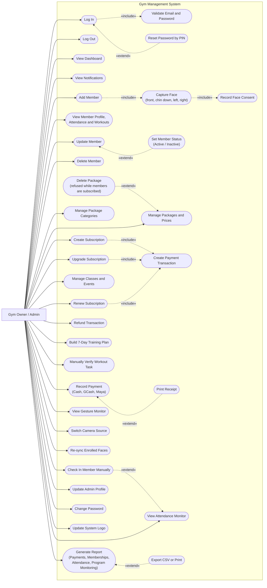
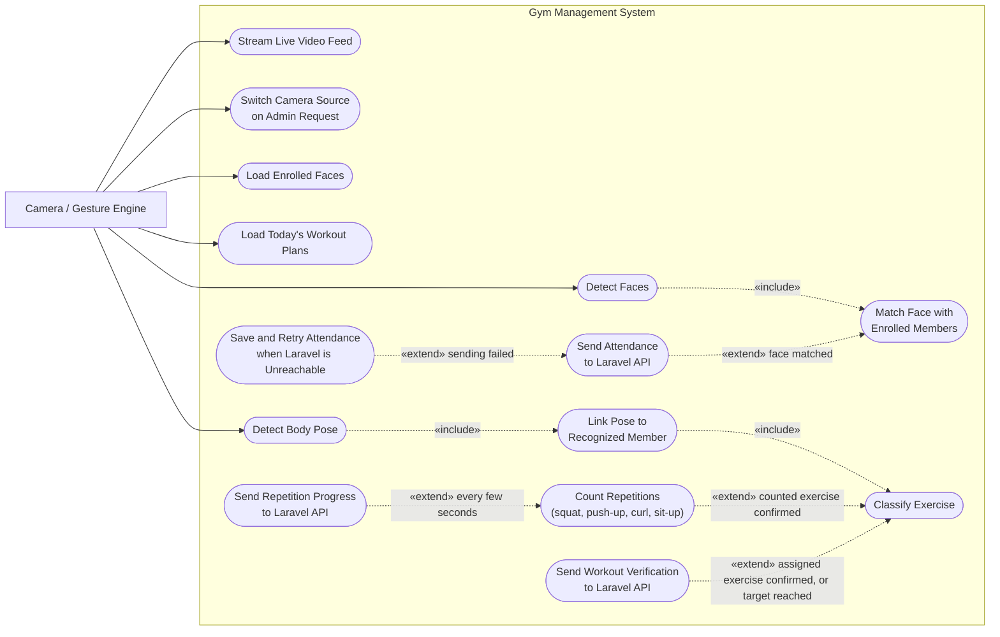
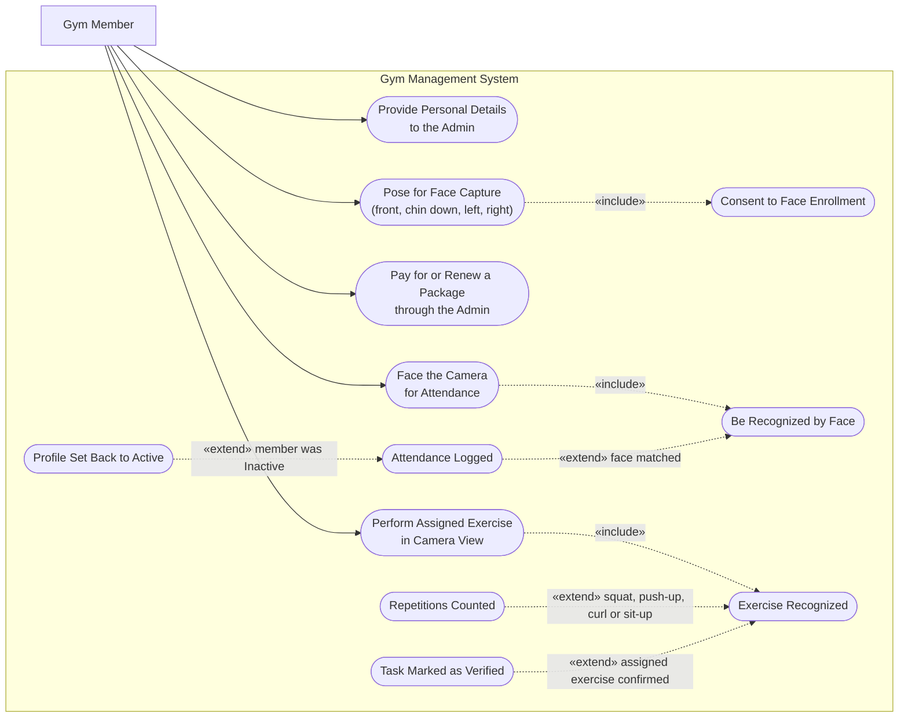

# 4. Use Case Diagram

[Back to the list of diagrams](../Correct_Diagrams.md)

> **Updated November 17, 2026** to match the system as built. The diagram is the same one as in `Updated Current Plan For Development/Chapter4_Diagrams (2).md`.

## 4.1 Gym Owner / Admin

## 4.2 Camera / Gesture Engine

## 4.3 Gym Member

