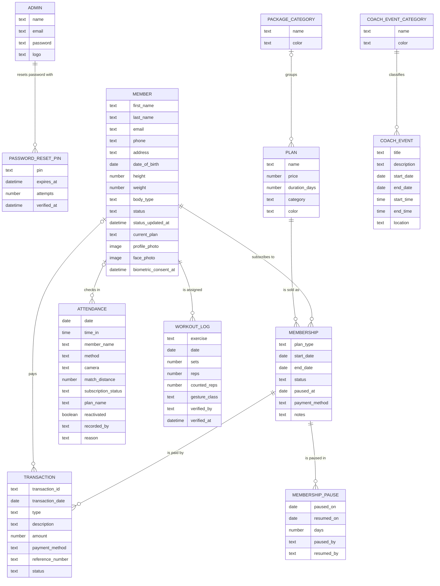

# 5. Logical Entity-Relationship Diagram

[Back to the list of diagrams](../Correct_Diagrams.md)

> **Updated November 17, 2026** to match the system as built. The diagram is the same one as in `Updated Current Plan For Development/Chapter4_Diagrams (2).md`.

> **Updated November 25, 2026:** refunds were replaced by pausing and resuming a subscription (new table `membership_pauses`), and the Attendance page was added.

