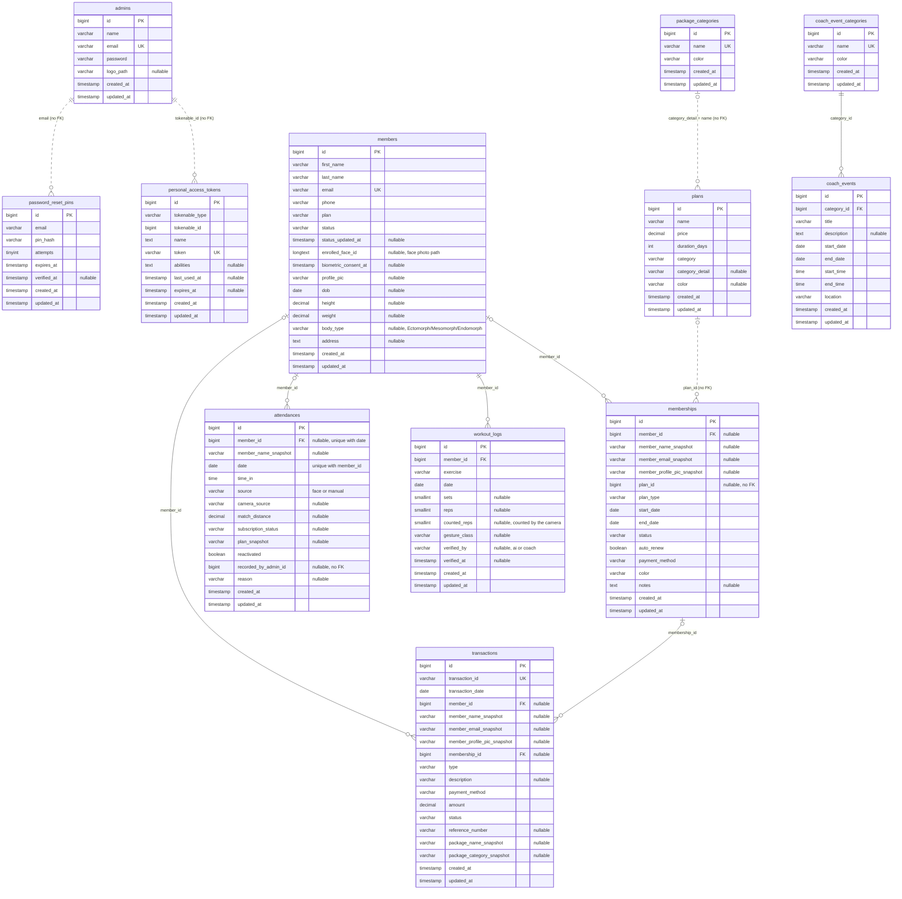

# 6. Physical Entity-Relationship Diagram

[Back to the list of diagrams](../Correct_Diagrams.md)

> **Updated November 17, 2026** to match the system as built. The diagram is the same one as in `Updated Current Plan For Development/Chapter4_Diagrams (2).md`.

Decimal sizes: `members.height` and `members.weight` are DECIMAL(5,2), `plans.price` is DECIMAL(9,2), `transactions.amount` is DECIMAL(10,2).

On delete: `workout_logs` are deleted with the member; `attendances.member_id`, `memberships.member_id`, `transactions.member_id` and `transactions.membership_id` are set to null; `coach_events.category_id` is restricted (a category with events cannot be deleted).

`memberships.plan_id` has no foreign key in the database (checked with `SHOW CREATE TABLE memberships;`). The application refuses to delete a package while a running subscription uses it, and an ended subscription keeps its package name in `plan_type`.

Not drawn because the application does not use them: `face_encodings`, `payments`, `exercise_sessions`, `gesture_logs`, `exercises`, `auth_verification_codes` (the login PIN was removed), `users`, and Laravel's own tables (`sessions`, `cache`, `jobs` and similar).
