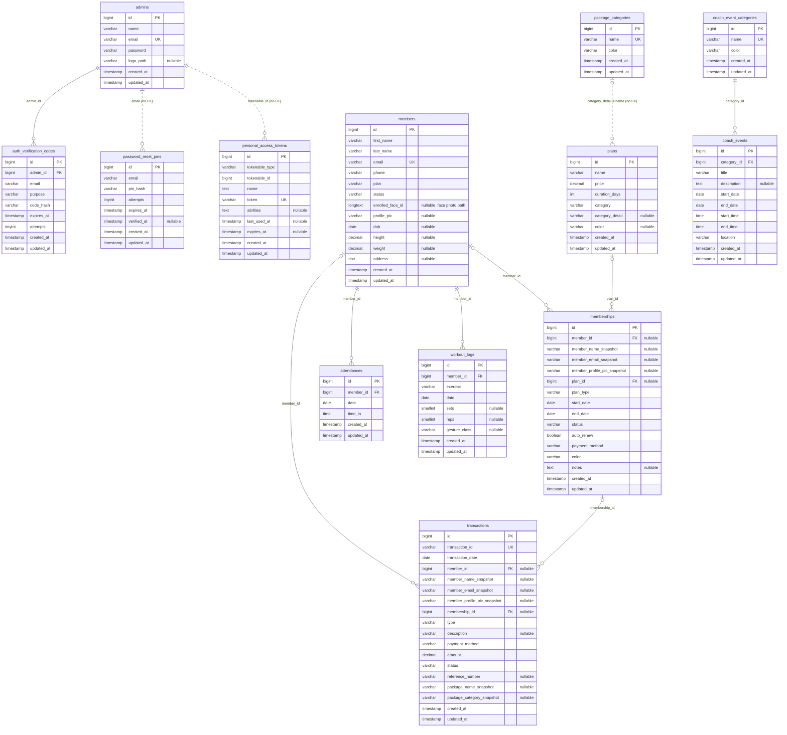

# 6. Physical Entity-Relationship Diagram

[Back to the list of diagrams](../Correct_Diagrams.md)

Decimal sizes: `members.height` and `members.weight` are DECIMAL(5,2), `plans.price` is DECIMAL(9,2), `transactions.amount` is DECIMAL(10,2).

On delete: `attendances`, `workout_logs` and `auth_verification_codes` cascade; `memberships.member_id`, `transactions.member_id` and `transactions.membership_id` are set to null; `coach_events.category_id` is restricted.

Confirm on your database before finalizing: whether `memberships.plan_id` has a real foreign key (`SHOW CREATE TABLE memberships;`). It is drawn here as one.

Not drawn because the application does not use them: `face_encodings`, `payments`, `exercise_sessions`, `gesture_logs`, `exercises`, `users`, and Laravel's own tables (`sessions`, `cache`, `jobs` and similar).
