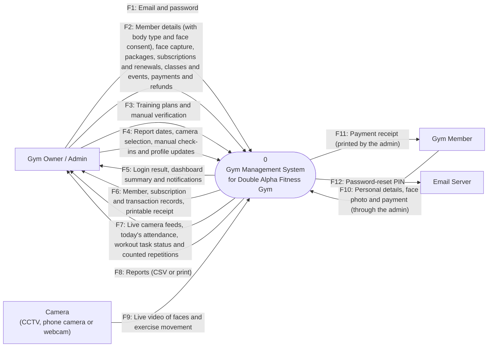

# 4.2-B Context Level Diagram

This section presents the **Context Level Diagram** (Data Flow Diagram Level 0) for the **IoT-Based Gym Management System with Facial Recognition Attendance and Gesture-Based Program Monitoring for Double Alpha Fitness Gym**.

> **Updated November 17, 2026** to match the system as built. The diagram is the same one as in `Updated Current Plan For Development/Chapter4_Diagrams (2).md`.

---

## 1. Introduction (INTRODUCE)

A **Context Level Diagram** is the highest-level map of a system. It shows the whole application as one process (**Process 0**) and every outside actor or device that exchanges data with it.

It answers three questions: **who interacts with the system** (external entities), **what goes in** (incoming flows) and **what comes out** (outgoing flows). Related data are grouped into a few flows, so the diagram stays readable while every function (registration, attendance, program monitoring, subscriptions, payments, reports) is represented.

---

## 2. Context Level Diagram (PRESENT)

**Figure 4.4.** Context Level Diagram for Double Alpha Fitness Gym.

---

## 3. Plain-English Explanation of Data Flows (EXPLAIN)

### A. The Gym Owner / Admin (primary user)
The gym owner and the coach share one administrator login and use the web application on a computer.

**Sends in:**
1. **F1: Email and password.** Signing in needs only these two. (If the password is forgotten, the admin asks for a PIN, which is emailed, and sets a new password.)
2. **F2: Member details, packages, payments.** Contact details, address, date of birth, height, weight and **body type**; the member's **consent** and the four **face captures**; packages and prices; subscriptions, **renewals** and upgrades; **classes and events** for the calendar; payments (Cash, GCash, Maya) and refunds.
3. **F3: Training plans and manual verification.** A 7-day plan per member (exercise, date, sets, reps), and confirmation by hand of tasks the camera cannot check.
4. **F4: Report dates, camera selection, manual check-ins and profile updates.** The date range of a report, the camera to watch, a manual check-in (member and reason), and the admin's own name, email, logo and password.

**Receives back:**
5. **F5: Login result, dashboard summary and notifications.** Today's check-ins, subscriptions ending soon, payments, income, classes and events this week, and alerts.
6. **F6: Member, subscription and transaction records and a printable receipt.**
7. **F7: Live camera feeds, today's attendance, workout task status and counted repetitions.** An expired subscription is flagged "RENEW" on the feed.
8. **F8: Reports** (Payments, Memberships, Attendance, Program Monitoring) as a table, a CSV file or a printout.

### B. The Camera (CCTV, phone camera or webcam)
9. **F9: Live video of faces and exercise movement.** The same video is used to recognize faces for attendance and to track the body for exercises. The system treats the camera as the source of video only; it does not control it.

### C. The Gym Member
Members never log in. They take part in person:
10. **F10: Personal details, face photo and payment (through the admin).**
11. **F11: Payment receipt**, printed by the admin.

### D. The Email Server
12. **F12: Password-reset PIN.** The only message the system sends by email.

---

## 4. Why This Diagram Matters for the Gym (INTERPRET)

1. **Members carry no software burden:** their presence and movement drive attendance and workout checks.
2. **Camera feeds are inputs only:** recognition and counting happen inside the system, and results go to the admin's screen.
3. **One administrator, one login:** the diagram has a single operator, matching how the gym works.
4. **Email is the smallest possible dependency:** it is used only to recover a password, so a down mail server cannot stop daily operations.
5. **Records in one place:** loose paper notes and payment screenshots become one organized database.

---

## 5. Connection to Study Objectives (CONNECT)

This diagram supports **Specific Objective (b)** by fixing the boundary of the system. It is the baseline for **Section 4.2-C (Level 1 Data Flow Diagram)**, where Process 0 is expanded into eight processes: Log In, View Dashboard, Manage Members, Attendance Monitoring, Program Monitoring, Packages and Subscriptions, Payment Transactions and Reports.
