# 4.2-C Data Flow Diagram (DFD Level 1)

This section presents the **Level 1 Data Flow Diagram** for the **IoT-Based Gym Management System with Facial Recognition Attendance and Gesture-Based Program Monitoring for Muscle Bros Gym**.

> **Updated November 17, 2026** to match the system as built. The diagram is the same one as in `Updated Current Plan For Development/Chapter4_Diagrams (2).md`.

---

## 1. Introduction (INTRODUCE)

A **Data Flow Diagram (DFD) Level 1** opens up Process 0 of the Context Level Diagram. It shows the main processes, the data stores they read and write, and the data that flows between them and the outside entities.

Each process is numbered (1.0 to 8.0), each data store is numbered (D1 to D11) and named after its database table or file store, and every arrow is labeled with the data it carries.

---

## 2. Data Flow Diagram for Gym Owner / Administrator (PRESENT)

```mermaid
flowchart LR
    Admin["Gym Owner / Admin"]
    Camera["Camera"]
    Mail["Email Server"]
    P1(["1.0<br/>Log In"])
    P2(["2.0<br/>View Dashboard"])
    P3(["3.0<br/>Manage Members"])
    P4(["4.0<br/>Attendance Monitoring"])
    P5(["5.0<br/>Program Monitoring"])
    P6(["6.0<br/>Packages and Subscriptions"])
    P7(["7.0<br/>Payment Transactions"])
    P8(["8.0<br/>Reports"])

    Admin -->|"Email, password; forgot-password request, PIN and new password"| P1
    P1 -->|"Login result, session token"| Admin
    S10[("D1 admins")]
    P1 <-->|"Admin account"| S10
    S12[("D9 personal_access_tokens")]
    P1 -->|"Session token"| S12
    S13[("D11 password_reset_pins")]
    P1 <-->|"Password-reset PIN"| S13
    P1 -->|"Password-reset PIN"| Mail

    Admin -->|"Dashboard request"| P2
    P2 -->|"Totals, sales chart, notifications"| Admin
    S20[("D2 members")]
    P2 ~~~ S20
    S20 -->|"Member count"| P2
    S21[("D7 memberships")]
    P2 ~~~ S21
    S21 -->|"Active and expiring subscriptions"| P2
    S22[("D8 transactions")]
    P2 ~~~ S22
    S22 -->|"Revenue"| P2
    S23[("D4 attendances")]
    P2 ~~~ S23
    S23 -->|"Today's check-ins"| P2
    S24[("D10 coach_events")]
    P2 ~~~ S24
    S24 -->|"Classes and events this week"| P2

    Admin -->|"Member details, body type, face capture, consent, member status"| P3
    P3 -->|"Member list and profiles"| Admin
    S30[("D2 members")]
    P3 <-->|"Member records"| S30
    S31[("D3 face photo files")]
    P3 -->|"Face photo"| S31

    Admin -->|"Camera selection, manual check-in"| P4
    P4 -->|"Live feed, today's check-ins"| Admin
    S40[("D2 members")]
    P4 ~~~ S40
    S40 -->|"Enrolled members"| P4
    P4 -->|"Returning member set back to Active"| S40
    S41[("D3 face photo files")]
    P4 ~~~ S41
    S41 -->|"Face photos"| P4
    S42[("D4 attendances")]
    P4 <-->|"Member, date, time in, method, camera, subscription status"| S42
    S43[("D7 memberships")]
    P4 ~~~ S43
    S43 -->|"Subscription on the check-in date"| P4

    Admin -->|"7-day training plan, manual verification"| P5
    P5 -->|"Task status, counted repetitions, workout history"| Admin
    S50[("D5 workout_logs")]
    P5 <-->|"Assigned tasks, counted repetitions, verified tasks"| S50
    S51[("D7 memberships")]
    P5 ~~~ S51
    S51 -->|"Active With Coach subscription"| P5

    Admin -->|"Packages, subscriptions, renewals, upgrades, classes and events"| P6
    P6 -->|"Package list, subscription status"| Admin
    S60[("D6 plans")]
    P6 <-->|"Packages"| S60
    S61[("D7 memberships")]
    P6 <-->|"Subscriptions"| S61
    S62[("D8 transactions")]
    P6 -->|"Automatic payment record"| S62
    S63[("D10 coach_events")]
    P6 <-->|"Classes and events"| S63

    Admin -->|"Payment details, refund request"| P7
    P7 -->|"Transaction list, receipt"| Admin
    S70[("D8 transactions")]
    P7 <-->|"Transactions"| S70
    S71[("D6 plans")]
    P7 ~~~ S71
    S71 -->|"Package name"| P7

    Admin -->|"Report type, date range"| P8
    P8 -->|"Report table, CSV or print"| Admin
    S80[("D8 transactions")]
    P8 ~~~ S80
    S80 -->|"Payments"| P8
    S81[("D7 memberships")]
    P8 ~~~ S81
    S81 -->|"Subscriptions"| P8
    S82[("D4 attendances")]
    P8 ~~~ S82
    S82 -->|"Check-ins"| P8
    S83[("D5 workout_logs")]
    P8 ~~~ S83
    S83 -->|"Workout tasks and counted repetitions"| P8

    Camera -->|"Live video"| P4
    Camera -->|"Live video"| P5
```

**Figure 4.5.** Data Flow Diagram (Level 1) for Muscle Bros Gym.

Data stores: D1 `admins`, D2 `members`, D3 face photo files (private storage), D4 `attendances`, D5 `workout_logs`, D6 `plans`, D7 `memberships`, D8 `transactions`, D9 `personal_access_tokens`, D10 `coach_events`, D11 `password_reset_pins`.

---

## 3. Detailed Discussion of Data Flows (EXPLAIN)

### Process 1.0: Log In
The admin sends an email and password. The system checks them against **D1 admins** and, if correct, creates a session token (**D9**) and returns it. There is no verification code. For a forgotten password the admin sends a request, the system creates a PIN in **D11 password_reset_pins** and emails it (**Email Server**); the admin returns the PIN and a new password, which replace the old one in D1.

### Process 2.0: View Dashboard
Reads **D2** (member count), **D7** (active and expiring subscriptions), **D8** (revenue), **D4** (today's check-ins) and **D10** (classes and events this week) and returns totals, a sales chart and notifications.

### Process 3.0: Manage Members
The admin enters member details (with body type), the face capture and the member's consent. The member record, with the consent date and status, is saved in **D2**, and the face photo in **D3**.

### Process 4.0: Attendance Monitoring
Live video from the camera is matched with the enrolled faces (**D2, D3**). A recognized member is saved in **D4** with the date, time, method, camera and subscription status read from **D7**; an Inactive member is set back to Active in D2. The admin can also make a manual check-in. The admin receives the live feed and today's check-ins.

### Process 5.0: Program Monitoring
The admin saves a 7-day training plan, stored as tasks in **D5**. Live video is read for members with an active With Coach subscription (**D7**). When the camera recognizes an assigned exercise it verifies the task or, for squat, push-up, curl and sit-up, counts repetitions and saves them in D5 until the target is reached. The admin can verify a task by hand. The admin receives task status, counted repetitions and the workout history.

### Process 6.0: Packages and Subscriptions
Packages are kept in **D6**, subscriptions in **D7** (including renewals and upgrades), and classes and events in **D10**. Each subscription, renewal or upgrade creates a payment record in **D8** automatically.

### Process 7.0: Payment Transactions
The admin records a payment or a refund in **D8**, using package names from **D6**, and receives the transaction list and a printable receipt.

### Process 8.0: Reports
Reads **D8** (Payments), **D7** (Memberships), **D4** (Attendance) and **D5** (Program Monitoring) for a report type and date range, and returns a table, a CSV file or a printout.

---

## 4. Analytical Interpretation (INTERPRET)

* **Every module has its own data:** each of the eight processes reads or writes at least one store, and no process is left without a record.
* **Automatic payment records:** subscriptions, renewals and upgrades write to D8 without a second entry, so the ledger matches the subscriptions.
* **The camera feeds two processes** (4.0 and 5.0) with the same video, so one camera serves both attendance and workout monitoring.
* **Eligibility is a data flow:** Process 5.0 reads D7 to know who has an active With Coach subscription, so sales data decides who is tracked.
* **Email touches only Process 1.0**, for password recovery.

---

## 5. Connection to Study Objectives and Next Phases (CONNECT)

This DFD fulfills **Specific Objective (b)** and is the baseline for the use case diagrams (Section 4.2-D), the logical and physical ERDs (4.2-E and 4.2-F), whose tables are the data stores D1 to D11 above, and for the integration test cases in the testing phase.
