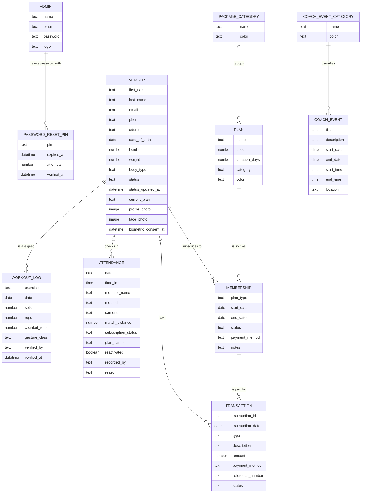

# 4.2-E Logical Entity-Relationship Diagram

This section presents the **Logical Entity-Relationship Diagram (ERD)** for the **IoT-Based Gym Management System with Facial Recognition Attendance and Gesture-Based Program Monitoring for Muscle Bros Gym**.

> **Updated November 17, 2026** to match the database and the system as built. The diagram is the same one as in `Updated Current Plan For Development/Chapter4_Diagrams (2).md`.

---

## 1. Logical Entity-Relationship Diagram (PRESENT)

**Figure 4.9.** Logical Entity-Relationship Diagram for Muscle Bros Gym.

---

## 2. Logical Entity and Relationship Matrix

| Entity | Description | Key business attributes | Related entities and cardinality |
|---|---|---|---|
| **ADMIN** | The system operator account; the gym owner and the coach share it. | `name`, `email`, `password`, `logo` | **1 : N** with `PASSWORD_RESET_PIN` (resets password with) |
| **PASSWORD_RESET_PIN** | An emailed PIN used to choose a new password. | `pin`, `expires_at`, `attempts`, `verified_at` | **N : 1** with `ADMIN` |
| **MEMBER** | A gym patron registered in the fitness center. | `first_name`, `last_name`, `email`, `phone`, `address`, `date_of_birth`, `height`, `weight`, `body_type`, `status`, `biometric_consent_at` | **1 : N** with `MEMBERSHIP` (subscribes to), `TRANSACTION` (pays; zero or one member), `ATTENDANCE` (checks in; zero or one member), `WORKOUT_LOG` (is assigned) |
| **PACKAGE_CATEGORY** | A custom grouping of packages (older feature). | `name`, `color` | **1 : N** with `PLAN` (groups; optional) |
| **PLAN** | A package the gym sells, with price and length. | `name`, `price`, `duration_days`, `category`, `color` | **1 : N** with `MEMBERSHIP` (is sold as) |
| **MEMBERSHIP** | A member's subscription to a package for a period. | `plan_type`, `start_date`, `end_date`, `status`, `payment_method` | **N : 1** with `MEMBER`; **N : 1** with `PLAN`; **1 : N** with `TRANSACTION` (is paid by) |
| **TRANSACTION** | A payment, upgrade, renewal or refund. | `transaction_id`, `transaction_date`, `type`, `amount`, `payment_method`, `reference_number`, `status` | **N : 1** with `MEMBER` (optional, none for a walk-in); **N : 1** with `MEMBERSHIP` (optional) |
| **ATTENDANCE** | One check-in per member per day, by face or manual. | `date`, `time_in`, `method`, `camera`, `match_distance`, `subscription_status`, `plan_name`, `reactivated`, `recorded_by`, `reason` | **N : 1** with `MEMBER` (optional: the record stays after the member is deleted) |
| **WORKOUT_LOG** | A training-plan task or camera detection. | `exercise`, `date`, `sets`, `reps`, `counted_reps`, `gesture_class`, `verified_by`, `verified_at` | **N : 1** with `MEMBER` |
| **COACH_EVENT_CATEGORY** | A category (with a colour) for classes and events. | `name`, `color` | **1 : N** with `COACH_EVENT` (classifies) |
| **COACH_EVENT** | A class or event shown on the calendar. | `title`, `description`, `start_date`, `end_date`, `start_time`, `end_time`, `location` | **N : 1** with `COACH_EVENT_CATEGORY` |

The face photo is not a separate entity: it is stored as a private image file and referenced by the member (`face_photo`).
