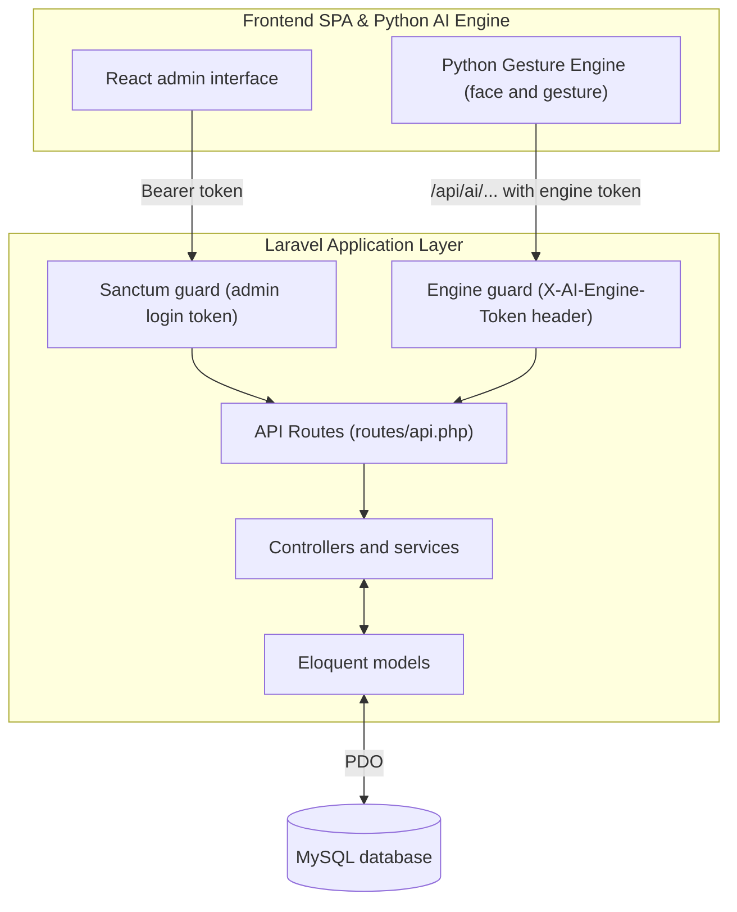
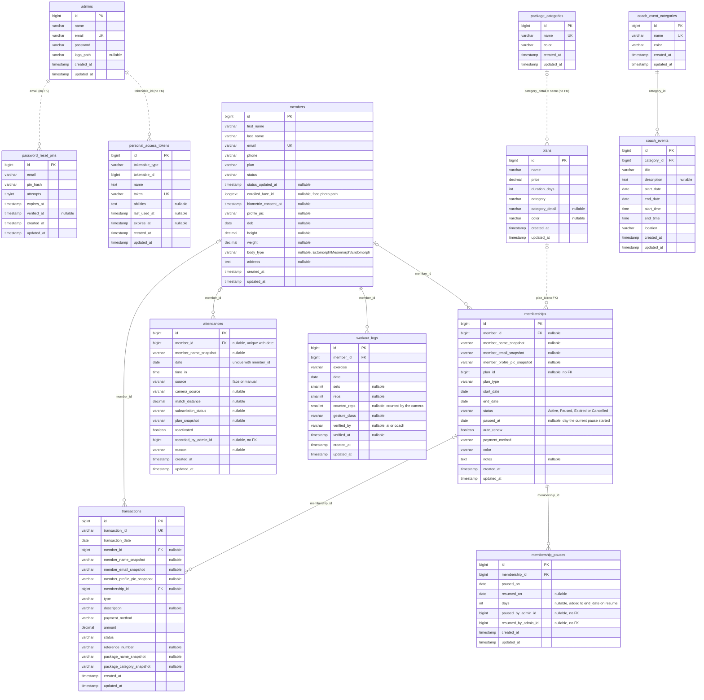

# Database Documentation & Laravel ORM Implementation

**Product Name:** IoT-Based Gym Management System with Facial Recognition Attendance and Gesture-Based Program Monitoring
**Client:** Muscle Bros Gym (Natumolan, Tagoloan, Misamis Oriental)
**Document Version:** 2.0
**Date:** November 17, 2026
**Describes:** the database and the business rules as built on this date (13 tables in use; updated November 25, 2026 for subscription pauses).

---

## 1. Database Overview

The system keeps its records in one **MySQL 8.0+** database. Everything is created and changed through **Laravel** migrations (`backend/database/migrations/`) and read and written through **Eloquent** models (`backend/app/Models/`). (The backend defaults to SQLite until the `DB_*` settings in `backend/.env` point it to MySQL.)

Characteristics:
* **Version-controlled structure:** every table and column change is a migration, so a new computer gets the same schema with `php artisan migrate`.
* **Audit timestamps:** the tables keep `created_at` and `updated_at`.
* **History survives deletions:** a deleted member's attendance, subscriptions and payments stay in the records, with the member's name saved on each row. Foreign keys use "set to empty on delete" for these tables; only the member's workout plan is deleted with the member.
* **One check-in per member per day** is enforced by a unique key on `attendances` (`member_id`, `date`), not only by the application.
* **One link is kept by the application, not the database:** `memberships.plan_id` has no foreign key. The application refuses to delete a package members are subscribed to.

---

## 2. How Laravel Interacts with the Database

Laravel is the business-logic and API layer between the **React admin interface**, the **Python Gesture Engine** and the database.



### 2.1. Migrations
Tables are declared in PHP with the Schema Builder (`$table->id()`, `foreignId()`, `string()`, `decimal()`, `date()`, `timestamps()`), and foreign keys state their delete rule (for example `nullOnDelete()`). Run `php artisan migrate` after every update; the system shows errors on the pages that read a new column until it is run.

### 2.2. Eloquent models
Models live in `app/Models/` (`Auth/Admin`, `Member/Member`, `Member/Membership`, `Member/Transaction`, `Gym/Plan`, `Gym/PackageCategory`, `Gym/CoachEvent`, `Gym/CoachEventCategory`, `Tracking/Attendance`, `Tracking/WorkoutLog`). Each lists its `$fillable` columns (mass-assignment protection). A `Member` has many `Membership`, `Transaction`, `Attendance` and `WorkoutLog` records; each of those has a `belongsTo(Member)`.

### 2.3. Business rules enforced in the backend
1. **Check-in rules (`AttendanceService`):** a check-in is recorded only inside gym hours (`GYM_OPEN_TIME` to `GYM_CLOSE_TIME`, default 09:00 to 21:30) and once per member per day. It saves how it was made (face or manual), the camera, the match distance, and the plan and subscription status that day. If the member was Inactive, the member becomes Active again.
2. **Inactivity rule (`MemberStatusService`):** an Active member with no check-in for a month becomes Inactive. It runs daily (`members:demote-inactive`) and once a day when the Overview or Attendance Monitor is opened. A manual status change, a check-in or a renewal gives the member a fresh month (`status_updated_at`).
3. **Subscriptions (`MembershipController`):** a member can have one running subscription. **Renew** extends a running subscription from its end date (a "Subscription Renewal" payment that does not count as upgrade credit) or, for an ended one, starts a new subscription today. **Upgrade** (editing to a higher-priced package) charges only the remaining balance and restarts the period. A subscription past its end date is shown as Expired.
4. **Package delete guard (`PlanController`):** a package is not deleted while a running subscription uses it.
5. **Coach eligibility (`Membership::scopeActiveWithCoach`):** a member is tracked by the Gesture Monitor only while they have an active subscription to a With Coach package (or, if the package was deleted, one whose saved package name contains "With Coach").
6. **Workouts (`WorkoutController`, `AiBridgeController`):** a plan is saved as tasks for the next 7 days. The engine reports the repetitions it counted while a member works (the count never goes down) and verifies the task when the target is reached; a coach can verify by hand. Each task records `verified_by` and `verified_at`.
7. **Payments (`TransactionController`):** receipts get codes such as TXN-001. Payments are never edited, deleted or refunded.
8. **Pausing (`MembershipController`):** instead of a refund, a running subscription can be paused (`POST /api/memberships/{id}/pause`): its status becomes Paused, `paused_at` is set and a `membership_pauses` row is added. Resuming (`POST /api/memberships/{id}/resume`) adds the paused days to `end_date`. While paused, a new sale or a renewal for the member is refused.

### 2.4. Authentication
The admin signs in with email and password (no verification code) and receives a **Sanctum** token stored in `personal_access_tokens`; every admin request must send it. The Python engine uses a separate shared secret in the `X-AI-Engine-Token` header (`AI_ENGINE_TOKEN`). The password-reset PIN is stored hashed in `password_reset_pins`.

---

## 3. Database Entity Relationship Diagram (ERD)



Notes: decimal sizes are `members.height` and `weight` DECIMAL(5,2), `plans.price` DECIMAL(9,2), `transactions.amount` DECIMAL(10,2), `attendances.match_distance` DECIMAL(5,4). On delete: `workout_logs` are deleted with the member and `membership_pauses` with their subscription; `attendances.member_id`, `memberships.member_id`, `transactions.member_id` and `transactions.membership_id` become empty; a category with events cannot be deleted. `memberships.plan_id` has no foreign key.

Tables in the database that the application does not use (not drawn): `face_encodings`, `payments`, `exercise_sessions`, `gesture_logs`, `exercises`, `auth_verification_codes`, `users` and Laravel's own tables.

---

## 4. Complete Database Table Specifications

### Table 1: `admins`
The administrator account. The gym owner and the coach share this one login.

| Column | Data type | Key / constraint | Nullable | Meaning |
|---|---|---|:---:|---|
| `id` | `BIGINT(20) UNSIGNED` | Primary key | No | Unique identifier |
| `name` | `VARCHAR(255)` | - | No | Administrator name |
| `email` | `VARCHAR(255)` | Unique | No | Login email (also receives the password-reset PIN) |
| `password` | `VARCHAR(255)` | - | No | Password, stored as a bcrypt hash |
| `created_at` | `TIMESTAMP` | - | Yes | When the record was created |
| `updated_at` | `TIMESTAMP` | - | Yes | When the record was last changed |
| `logo_path` | `VARCHAR(255)` | - | Yes | The system logo image shown in the app and on printouts |

### Table 2: `password_reset_pins`
One emailed 6-digit PIN per administrator email while a password is being reset (valid 10 minutes, 5 wrong tries).

| Column | Data type | Key / constraint | Nullable | Meaning |
|---|---|---|:---:|---|
| `id` | `BIGINT(20) UNSIGNED` | Primary key | No | Unique identifier |
| `email` | `VARCHAR(255)` | - | No | Administrator email the PIN was sent to (no foreign key) |
| `pin_hash` | `VARCHAR(255)` | - | No | The PIN, stored hashed |
| `attempts` | `TINYINT(3) UNSIGNED (default 0)` | - | No | Wrong guesses so far (the PIN is refused after 5) |
| `expires_at` | `TIMESTAMP (default current_timestamp())` | - | No | PIN expiry (10 minutes after it was sent) |
| `verified_at` | `TIMESTAMP` | - | Yes | When the correct PIN was entered; a new password can then be set |
| `created_at` | `TIMESTAMP` | - | Yes | When the record was created |
| `updated_at` | `TIMESTAMP` | - | Yes | When the record was last changed |

### Table 3: `personal_access_tokens`
Laravel Sanctum login tokens. A token is created at login and deleted at logout.

| Column | Data type | Key / constraint | Nullable | Meaning |
|---|---|---|:---:|---|
| `id` | `BIGINT(20) UNSIGNED` | Primary key | No | Unique identifier |
| `tokenable_type` | `VARCHAR(255)` | - | No | Model the token belongs to (the admin) |
| `tokenable_id` | `BIGINT(20) UNSIGNED` | - | No | Id of the admin (no foreign key) |
| `name` | `TEXT` | - | No | Token name (admin-token) |
| `token` | `VARCHAR(64)` | Unique | No | Hashed token value |
| `abilities` | `TEXT` | - | Yes | Token permissions |
| `last_used_at` | `TIMESTAMP` | - | Yes | Last time the token was used |
| `expires_at` | `TIMESTAMP` | - | Yes | Token expiry (SANCTUM_TOKEN_EXPIRATION minutes) |
| `created_at` | `TIMESTAMP` | - | Yes | When the record was created |
| `updated_at` | `TIMESTAMP` | - | Yes | When the record was last changed |

### Table 4: `members`
Every registered gym member: contact details, body measurements, status and the face photo reference.

| Column | Data type | Key / constraint | Nullable | Meaning |
|---|---|---|:---:|---|
| `id` | `BIGINT(20) UNSIGNED` | Primary key | No | Unique identifier |
| `first_name` | `VARCHAR(255)` | - | No | Given name |
| `last_name` | `VARCHAR(255)` | - | No | Family name |
| `email` | `VARCHAR(255)` | Unique | No | Contact email |
| `phone` | `VARCHAR(255)` | - | No | Mobile number |
| `plan` | `VARCHAR(255) (default None)` | - | No | Name of the member's current package (a display copy) |
| `status` | `VARCHAR(255) (default Active)` | - | No | Active or Inactive. Becomes Inactive after a month without a check-in; a check-in, a renewal or the admin sets it back to Active |
| `status_updated_at` | `TIMESTAMP` | - | Yes | When the status was last set; gives the member a fresh month before the inactivity rule applies |
| `enrolled_face_id` | `LONGTEXT` | - | Yes | Path of the face photo (the stacked face views) in private storage |
| `biometric_consent_at` | `TIMESTAMP` | - | Yes | When the member agreed to face enrollment (RA 10173) |
| `profile_pic` | `VARCHAR(255)` | - | Yes | Profile picture file |
| `created_at` | `TIMESTAMP` | - | Yes | When the record was created |
| `updated_at` | `TIMESTAMP` | - | Yes | When the record was last changed |
| `dob` | `DATE` | - | Yes | Date of birth |
| `height` | `DECIMAL(5,2)` | - | Yes | Height in centimetres |
| `weight` | `DECIMAL(5,2)` | - | Yes | Weight in kilograms |
| `body_type` | `VARCHAR(20)` | - | Yes | Ectomorph, Mesomorph or Endomorph; helps the coach assign a program |
| `address` | `TEXT` | - | Yes | Home address |

### Table 5: `package_categories`
Names and colours of custom package categories (older feature; the screen now offers three fixed categories).

| Column | Data type | Key / constraint | Nullable | Meaning |
|---|---|---|:---:|---|
| `id` | `BIGINT(20) UNSIGNED` | Primary key | No | Unique identifier |
| `name` | `VARCHAR(100)` | Unique | No | Category name |
| `color` | `VARCHAR(7)` | - | No | Category colour (hex) |
| `created_at` | `TIMESTAMP` | - | Yes | When the record was created |
| `updated_at` | `TIMESTAMP` | - | Yes | When the record was last changed |

### Table 6: `plans`
The packages the gym sells (Daily, Monthly, With Coach...), with their price and length.

| Column | Data type | Key / constraint | Nullable | Meaning |
|---|---|---|:---:|---|
| `id` | `BIGINT(20) UNSIGNED` | Primary key | No | Unique identifier |
| `name` | `VARCHAR(255)` | - | No | Package name |
| `price` | `DECIMAL(9,2)` | - | No | Price in pesos |
| `duration_days` | `INT(11)` | - | No | How many days the package lasts |
| `created_at` | `TIMESTAMP` | - | Yes | When the record was created |
| `updated_at` | `TIMESTAMP` | - | Yes | When the record was last changed |
| `category` | `VARCHAR(255) (default normal)` | - | No | normal, with_coach or walk_in (other = older custom category). With Coach packages unlock the training plan and camera tracking |
| `category_detail` | `VARCHAR(255)` | - | Yes | Name of an older custom category |
| `color` | `VARCHAR(7)` | - | Yes | Colour shown on the calendar (hex) |

### Table 7: `memberships`
A member's subscription to a package for a period. Keeps the member's name and the package name so history survives deletions.

| Column | Data type | Key / constraint | Nullable | Meaning |
|---|---|---|:---:|---|
| `id` | `BIGINT(20) UNSIGNED` | Primary key | No | Unique identifier |
| `member_id` | `BIGINT(20) UNSIGNED` | Foreign key to `members` (set to empty on delete) | Yes | The member; empty after the member is deleted |
| `member_name_snapshot` | `VARCHAR(255)` | - | Yes | Member name when the subscription was made |
| `member_email_snapshot` | `VARCHAR(255)` | - | Yes | Member email when the subscription was made |
| `member_profile_pic_snapshot` | `VARCHAR(255)` | - | Yes | Member picture when the subscription was made |
| `plan_type` | `VARCHAR(255)` | - | No | Package name saved on the subscription (stays after the package is deleted) |
| `start_date` | `DATE` | - | No | First day |
| `end_date` | `DATE` | - | No | Last day. A renewal of a running subscription moves this date forward |
| `status` | `VARCHAR(255) (default Active)` | - | No | Active, Paused, Expired or Cancelled (a running subscription past its end date is shown as Expired) |
| `paused_at` | `DATE` | - | Yes | Day the current pause started; empty when not paused. On resume the paused days are added to `end_date` |
| `auto_renew` | `TINYINT(1) (default 0)` | - | No | Always 0: the gym does not bill automatically; renewals are made at the desk |
| `payment_method` | `VARCHAR(255) (default Cash)` | - | No | Cash, Gcash or Maya |
| `color` | `VARCHAR(255) (default #f59e0b)` | - | No | Colour shown on the calendar (hex) |
| `notes` | `TEXT` | - | Yes | Free-text notes |
| `created_at` | `TIMESTAMP` | - | Yes | When the record was created |
| `updated_at` | `TIMESTAMP` | - | Yes | When the record was last changed |
| `plan_id` | `BIGINT(20) UNSIGNED` | - | Yes | The package. There is no foreign key: the application keeps the link, and refuses to delete a package members are subscribed to |

### Table 8: `transactions`
Every payment, upgrade and renewal, with the details needed to print a receipt. Payments are never edited, deleted or refunded.

| Column | Data type | Key / constraint | Nullable | Meaning |
|---|---|---|:---:|---|
| `id` | `BIGINT(20) UNSIGNED` | Primary key | No | Unique identifier |
| `transaction_id` | `VARCHAR(255)` | Unique | No | Receipt number such as TXN-001 |
| `transaction_date` | `DATE` | - | No | Date of the payment |
| `member_id` | `BIGINT(20) UNSIGNED` | Foreign key to `members` (set to empty on delete) | Yes | The member; empty for a walk-in guest or a deleted member |
| `member_name_snapshot` | `VARCHAR(255)` | - | Yes | Member name at the time |
| `member_email_snapshot` | `VARCHAR(255)` | - | Yes | Member email at the time |
| `member_profile_pic_snapshot` | `VARCHAR(255)` | - | Yes | Member picture at the time |
| `membership_id` | `BIGINT(20) UNSIGNED` | Foreign key to `memberships` (set to empty on delete) | Yes | The subscription this payment is for |
| `type` | `VARCHAR(255)` | - | No | Subscription Payment, Subscription Upgrade, Subscription Renewal, Subscription, Walk-In, Walk-in Guest or Packages |
| `description` | `VARCHAR(255)` | - | Yes | Short description of what was paid |
| `payment_method` | `VARCHAR(255)` | - | No | Cash, Gcash or Maya |
| `amount` | `DECIMAL(10,2)` | - | No | Amount in pesos |
| `status` | `VARCHAR(255) (default Complete)` | - | No | Complete |
| `reference_number` | `VARCHAR(255)` | - | Yes | GCash / Maya reference or receipt number |
| `created_at` | `TIMESTAMP` | - | Yes | When the record was created |
| `updated_at` | `TIMESTAMP` | - | Yes | When the record was last changed |
| `package_name_snapshot` | `VARCHAR(255)` | - | Yes | Package name at the time |
| `package_category_snapshot` | `VARCHAR(255)` | - | Yes | Package category at the time |

### Table 9: `attendances`
One check-in per member per day, by face or by the admin, with what was true on that day.

| Column | Data type | Key / constraint | Nullable | Meaning |
|---|---|---|:---:|---|
| `id` | `BIGINT(20) UNSIGNED` | Primary key | No | Unique identifier |
| `member_id` | `BIGINT(20) UNSIGNED` | Unique together with date; Foreign key to `members` (set to empty on delete) | Yes | The member; empty after the member is deleted (the name stays) |
| `member_name_snapshot` | `VARCHAR(255)` | - | Yes | Member name at check-in |
| `date` | `DATE` | Unique together with member_id | No | Day of the check-in |
| `time_in` | `TIME` | - | No | Time of the check-in |
| `source` | `VARCHAR(20) (default face)` | - | No | face (camera) or manual (admin) |
| `camera_source` | `VARCHAR(30)` | - | Yes | Camera used: cctv, cctv_2, cctv_3, webcam or phone |
| `match_distance` | `DECIMAL(5,4)` | - | Yes | How close the face match was (lower is closer) |
| `subscription_status` | `VARCHAR(20)` | - | Yes | active, expired or none on that day |
| `plan_snapshot` | `VARCHAR(255)` | - | Yes | Package name on that day |
| `reactivated` | `TINYINT(1) (default 0)` | - | No | Whether this check-in set an Inactive member back to Active |
| `recorded_by_admin_id` | `BIGINT(20) UNSIGNED` | - | Yes | Administrator who made a manual check-in (no foreign key) |
| `reason` | `VARCHAR(255)` | - | Yes | Reason typed for a manual check-in |
| `created_at` | `TIMESTAMP` | - | Yes | When the record was created |
| `updated_at` | `TIMESTAMP` | - | Yes | When the record was last changed |

### Table 10: `workout_logs`
Training-plan tasks and camera detections. A task is pending while its exercise starts with "ASSIGNED: ".

| Column | Data type | Key / constraint | Nullable | Meaning |
|---|---|---|:---:|---|
| `id` | `BIGINT(20) UNSIGNED` | Primary key | No | Unique identifier |
| `member_id` | `BIGINT(20) UNSIGNED` | Foreign key to `members` (deleted with it on delete) | No | The member the task belongs to |
| `exercise` | `VARCHAR(255)` | - | No | Exercise name; starts with "ASSIGNED: " until the task is verified |
| `date` | `DATE` | - | No | The day the task is for (or was done) |
| `created_at` | `TIMESTAMP` | - | Yes | When the record was created |
| `updated_at` | `TIMESTAMP` | - | Yes | When the record was last changed |
| `sets` | `SMALLINT(5) UNSIGNED` | - | Yes | Target number of sets |
| `reps` | `SMALLINT(5) UNSIGNED` | - | Yes | Target repetitions per set |
| `counted_reps` | `SMALLINT(5) UNSIGNED` | - | Yes | Total repetitions counted by the camera (squat, push-up, curl, sit-up) |
| `gesture_class` | `VARCHAR(255)` | - | Yes | The camera exercise class this task is checked as (empty = coach verifies) |
| `verified_by` | `VARCHAR(10)` | - | Yes | ai (camera) or coach |
| `verified_at` | `TIMESTAMP` | - | Yes | When the task was verified |

### Table 11: `coach_event_categories`
Categories (with a colour) for classes and events on the calendar.

| Column | Data type | Key / constraint | Nullable | Meaning |
|---|---|---|:---:|---|
| `id` | `BIGINT(20) UNSIGNED` | Primary key | No | Unique identifier |
| `name` | `VARCHAR(80)` | Unique | No | Category name |
| `color` | `VARCHAR(7) (default #3b82f6)` | - | No | Category colour (hex) |
| `created_at` | `TIMESTAMP` | - | Yes | When the record was created |
| `updated_at` | `TIMESTAMP` | - | Yes | When the record was last changed |

### Table 12: `coach_events`
Classes and events shown on the Packages calendar and the Overview.

| Column | Data type | Key / constraint | Nullable | Meaning |
|---|---|---|:---:|---|
| `id` | `BIGINT(20) UNSIGNED` | Primary key | No | Unique identifier |
| `category_id` | `BIGINT(20) UNSIGNED` | Foreign key to `coach_event_categories` (blocks the delete on delete) | No | The event category |
| `title` | `VARCHAR(255)` | - | No | Event title |
| `description` | `TEXT` | - | Yes | Details |
| `start_date` | `DATE` | - | No | First day |
| `end_date` | `DATE` | - | No | Last day |
| `start_time` | `TIME` | - | No | Start time |
| `end_time` | `TIME` | - | No | End time |
| `location` | `VARCHAR(255)` | - | No | Where it takes place |
| `created_at` | `TIMESTAMP` | - | Yes | When the record was created |
| `updated_at` | `TIMESTAMP` | - | Yes | When the record was last changed |

### Table 13: `membership_pauses`
One row per pause of a subscription (the gym gives no refunds; a subscription is paused instead). Kept as history.

| Column | Data type | Key / constraint | Nullable | Meaning |
|---|---|---|:---:|---|
| `id` | `BIGINT(20) UNSIGNED` | Primary key | No | Unique identifier |
| `membership_id` | `BIGINT(20) UNSIGNED` | Foreign key to `memberships` (deleted with the subscription) | No | The paused subscription |
| `paused_on` | `DATE` | - | No | Day the pause started |
| `resumed_on` | `DATE` | - | Yes | Day it was resumed; empty while still paused |
| `days` | `INT UNSIGNED` | - | Yes | Days spent paused, added to `memberships.end_date` on resume |
| `paused_by_admin_id` | `BIGINT(20) UNSIGNED` | - | Yes | Admin who paused it (no foreign key) |
| `resumed_by_admin_id` | `BIGINT(20) UNSIGNED` | - | Yes | Admin who resumed it (no foreign key) |
| `created_at` | `TIMESTAMP` | - | Yes | When the record was created |
| `updated_at` | `TIMESTAMP` | - | Yes | When the record was last changed |

---

## 5. Implementation Patterns (from the code)

### 5.1. Who is tracked by the Gesture Monitor
Simplified from `Membership::scopeActiveWithCoach`:
```php
public function scopeActiveWithCoach(Builder $query): Builder
{
    return $query
        ->where('status', 'Active')
        ->whereDate('start_date', '<=', today())
        ->whereDate('end_date', '>=', today())
        ->where(function (Builder $query) {
            $query->whereHas('plan', fn ($plan) => $plan->where('category', 'with_coach'))
                ->orWhere(function (Builder $unlinked) {
                    // The package was deleted: use the name saved on the subscription.
                    $unlinked->whereDoesntHave('plan')
                        ->whereRaw('LOWER(plan_type) LIKE ?', ['%with coach%']);
                });
        });
}
```

### 5.2. One check-in per member per day
Simplified from `AttendanceService::checkIn`. The unique key on (`member_id`, `date`) is the final guard if two requests arrive together:
```php
if (!$this->isWithinOperatingHours($at)) return OUTSIDE_HOURS;
if (Attendance::where('member_id', $member->id)->where('date', $date)->exists()) return ALREADY_LOGGED;

try {
    DB::transaction(function () use (...) {
        Attendance::create([...]);              // source, camera, subscription status, plan...
        if ($wasInactive) $member->forceFill(['status' => 'Active', 'status_updated_at' => now()])->save();
    });
} catch (UniqueConstraintViolationException) {
    return ALREADY_LOGGED;                      // another request got there first
}
```

### 5.3. Renewing a subscription
Simplified from `MembershipController::renew` (inside a database transaction):
```php
$isActive = $membership->status === 'Active' && Carbon::parse($membership->end_date)->gte(today());

if ($isActive) {        // keep every paid day: extend from the current end date
    $membership->update(['end_date' => Carbon::parse($membership->end_date)->addDays($days)]);
    $type = 'Subscription Renewal';
} else {                // ended: a new subscription starts today
    $membership = Membership::create([... 'start_date' => today(), 'end_date' => today()->addDays($days)]);
    $type = 'Subscription Payment';
}
Transaction::create([... 'membership_id' => $membership->id, 'type' => $type, 'amount' => $amount]);
```

---

## 6. Summary Matrix of Database Technology Stack

| Layer / Aspect | Selected Technology | Purpose |
| :--- | :--- | :--- |
| **Relational DBMS** | MySQL 8.0+ | Persistent centralized data storage |
| **ORM Framework** | Laravel Eloquent | Object-relational mapping and relationships |
| **Schema Migration** | Laravel Schema Builder | Database version control and table structure |
| **Authentication** | Laravel Sanctum | Login tokens in `personal_access_tokens` |
| **Seeders** | Laravel Database Seeders | The first administrator account (and the `exercises` table, which the screens do not read) |
| **Date/time rules** | Carbon | Gym hours, subscription end dates, the inactivity rule |
| **Private files** | Laravel storage (`storage/app/private`) | Enrolled face photos (not reachable from a browser) |
