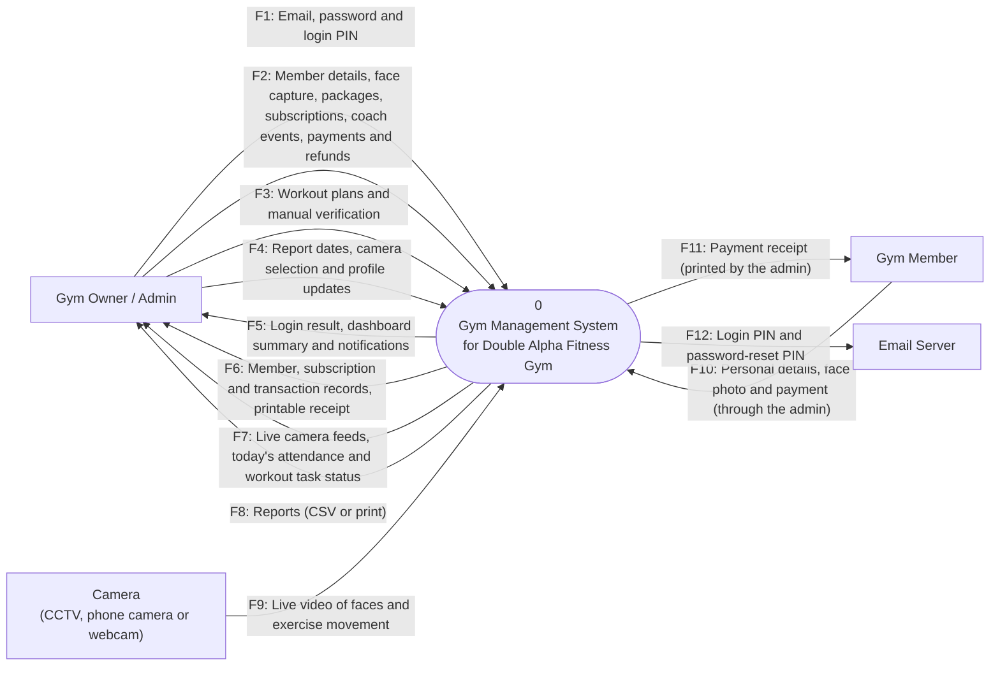
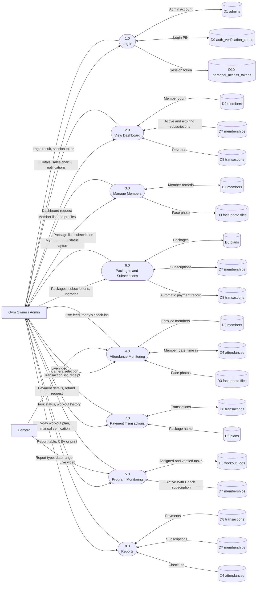
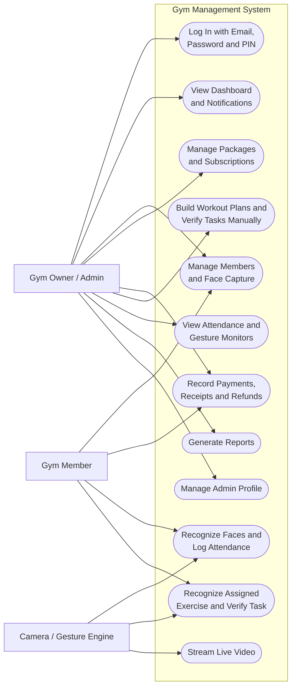
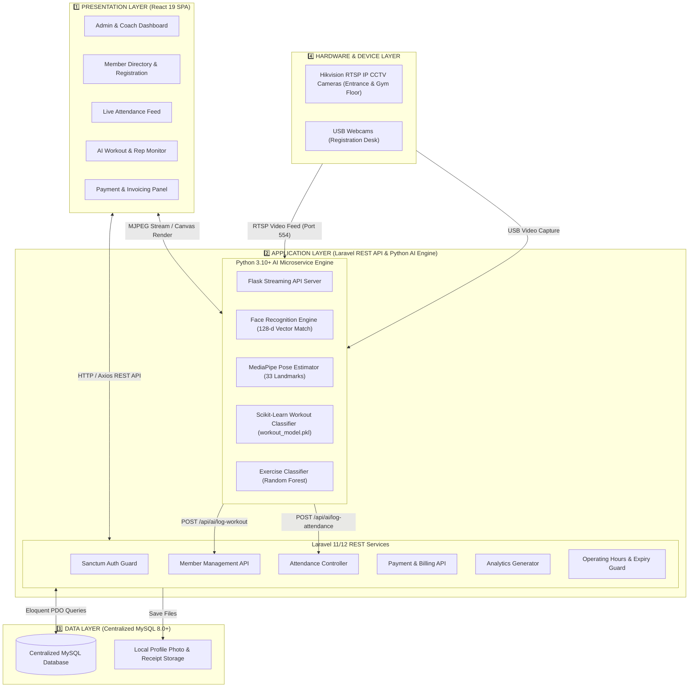
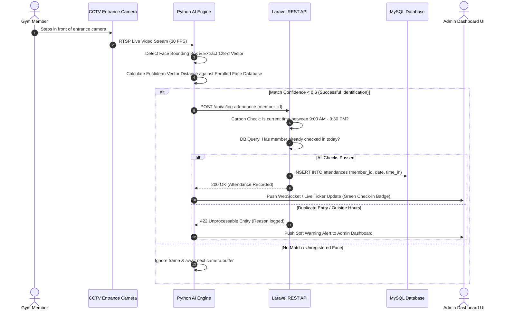
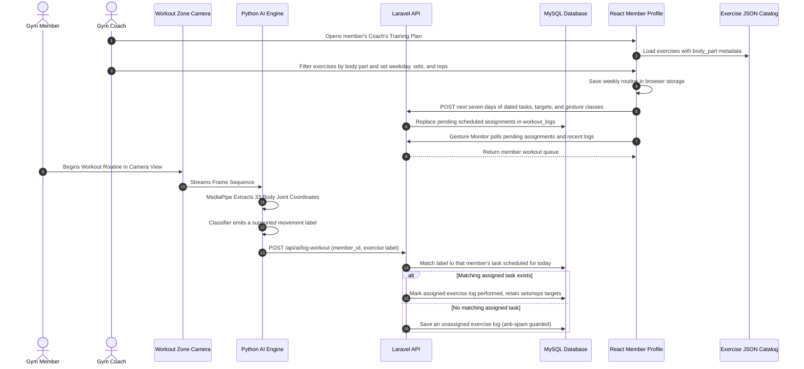

# System Diagrams & Visual Models Document

**Product Name:** Camera-Based Gym Management System with Facial Recognition Attendance and Gesture-Based Program Monitoring  
**Client:** Double Alpha Fitness Gym (Natumolan, Tagoloan, Misamis Oriental)  
**Document Version:** 1.0  
**Date:** September 2026  

---

## 1. Executive Summary

This document provides a comprehensive visual and structural modeling specification for the **Camera-Based Gym Management System with Facial Recognition Attendance and Gesture-Based Program Monitoring** at Double Alpha Fitness Gym. 

It encompasses all standard software engineering diagrams required for technical analysis, system design, capstone defense, and architecture validation:
1. **Input-Process-Output (IPO) Conceptual Model**
2. **System Context Diagram (Level 0 DFD)**
3. **Data Flow Diagram Level 1 (DFD Level 1)**
4. **Use Case Diagram (UCD) & Actor Specifications**
5. **System Architecture & Hardware Topology Diagram**
6. **Operational Sequence Diagrams** (Biometric Check-In, Gesture Verification, Payment Processing)

---

## 2. Input-Process-Output (IPO) Model

The Input-Process-Output (IPO) model illustrates the high-level operational data flow of the proposed system from initial data capture to final generated output reports.

```mermaid
flowchart LR
    subgraph INPUT ["📥 INPUT PHASE"]
        direction TB
        I1["Member Personal Data\n(Name, Contact, Address)"]
        I2["Anthropometric & Body Metrics\n(Height, Weight, Date of Birth)"]
        I3["Biometric Facial Enrollment\n(Face Vector Encodings)"]
        I4["Program Assignments\n(Exercise Types & Rep Targets)"]
        I5["Payment Transaction Info\n(Amount, Method: Cash/GCash/Maya)"]
        I6["Live Video Streams\n(RTSP CCTV / USB Webcams)"]
    end

    subgraph PROCESS ["⚙️ PROCESS PHASE"]
        direction TB
        P1["Member Registration & Profile Creation"]
        P2["Touchless Facial Recognition Attendance Check-In"]
        P3["MediaPipe Pose Tracking & Exercise Classification"]
        P4["Subscription Expiration & Status Auditor"]
        P5["Payment Transaction Invoicing & Billing Log"]
        P6["Executive Analytics & Report Aggregation"]
    end

    subgraph OUTPUT ["📤 OUTPUT PHASE"]
        direction TB
        O1["Enrolled Member Profiles & Badges"]
        O2["Daily Attendance Logs & Timestamps"]
        O3["AI-Verified Workout & Rep Reports"]
        O4["Automated Subscription Renewal Alerts"]
        O5["Digital Payment Receipts & Financial Ledger"]
        O6["Executive Dashboard Analytics & Exported Reports"]
    end

    INPUT --> PROCESS --> OUTPUT
```

> **Note:** This diagram was updated on 2026-11-11 to match the current system. The written explanation in this file may still describe the earlier version of the diagram.

---

## 3. System Context Diagram (Level 0 DFD)

The Context Diagram defines the system boundary, showcasing external entities interacting with the central **Camera-Based Gym Management System**.

> **Note:** This diagram was updated on 2026-11-11 to match the current system. The written explanation in this file may still describe the earlier version of the diagram.

---

## 4. Data Flow Diagram Level 1 (DFD Level 1)

DFD Level 1 decomposes the main system into six primary sub-processes and maps how data moves between external entities, processes, and central MySQL data stores.

> **Note:** This diagram was updated on 2026-11-11 to match the current system. The written explanation in this file may still describe the earlier version of the diagram.

---

## 5. Use Case Diagram (UCD) & Actor Specifications

The Use Case Diagram highlights all functional interactions provided by the system, categorized by user roles and automated AI camera actors.

> **Note:** This diagram was updated on 2026-11-11 to match the current system. The written explanation in this file may still describe the earlier version of the diagram.

### Actor Description Matrix

| Actor | Type | Description & System Responsibilities |
| :--- | :--- | :--- |
| **Gym Owner / Admin** | Primary Human Actor | Full system access: manages member accounts, plan configurations, financial transactions, payment logging, system reporting, and live camera feed viewing. |
| **Gym Coach / Trainer** | Human Actor | Manages athlete workout routines, monitors live AI rep counting, assigns custom workout tasks, and performs manual verification overrides. |
| **Gym Member** | External Human Participant | Participates in registration, biometrics face enrollment, touchless attendance check-in, and assigned gesture workout sessions. |
| **AI Vision Camera Engine** | Automated Hardware/Software Actor | Captures RTSP/USB video feeds, executes facial recognition matching, extracts MediaPipe 3D pose landmarks, and calculates repetitions. |

---

## 6. System Architecture & Topology Model

> **Note:** This diagram was updated on 2026-11-11 to match the current system. The written explanation in this file may still describe the earlier version of the diagram.

---

## 7. Operational Sequence Diagrams

### 7.1. Touchless Facial Recognition Attendance Check-In Sequence

> **Note:** This diagram was updated on 2026-11-11 to match the current system. The written explanation in this file may still describe the earlier version of the diagram.

---

### 7.2. Gesture Workout Verification Sequence

> **Note:** This diagram was updated on 2026-11-11 to match the current system. The written explanation in this file may still describe the earlier version of the diagram.

---

## 8. Diagram Summary Reference Matrix

| Diagram Type | Primary Purpose | Key Components & Standards |
| :--- | :--- | :--- |
| **IPO Model** | Conceptual System Flow | Categorizes System Inputs, Core Processes, and Generated Outputs |
| **Context Diagram (DFD L0)** | System Boundary & Entities | Defines high-level interaction between Admin, Member, Coach, Camera & System |
| **DFD Level 1** | Process & Data Store Mapping | Decomposes system into 6 core processes interacting with 6 MySQL data tables |
| **Use Case Diagram (UCD)** | Functional User Roles | Maps 11 use cases across 4 primary actors (Admin, Coach, Member, AI Camera) |
| **System Architecture** | Technical Tier Composition | 4-Layer model (Presentation, Application REST/AI, Data Layer, Hardware Layer) |
| **Sequence Diagrams** | Step-by-Step Runtime Logic | Detail execution sequences for touchless check-in and gesture rep counting |
