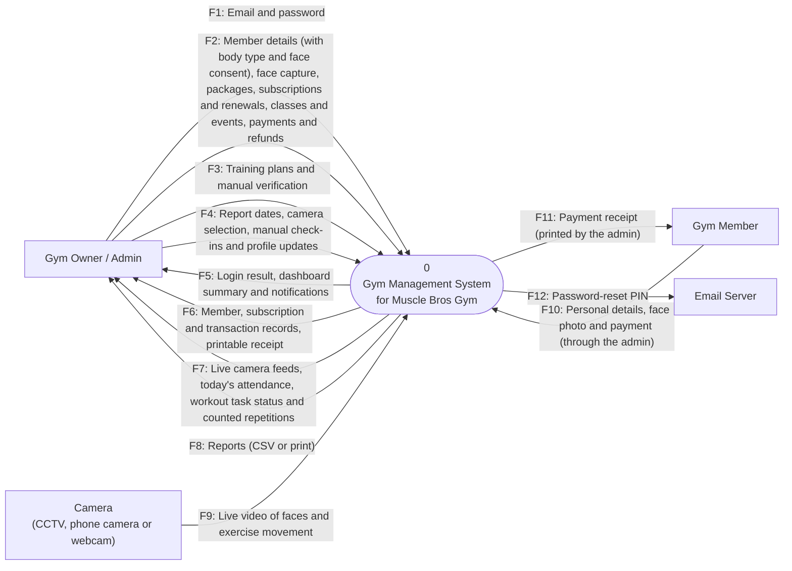
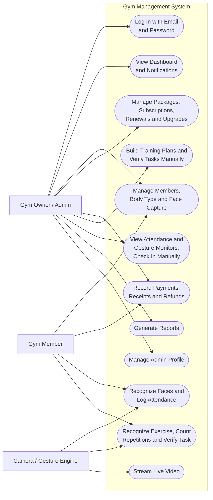
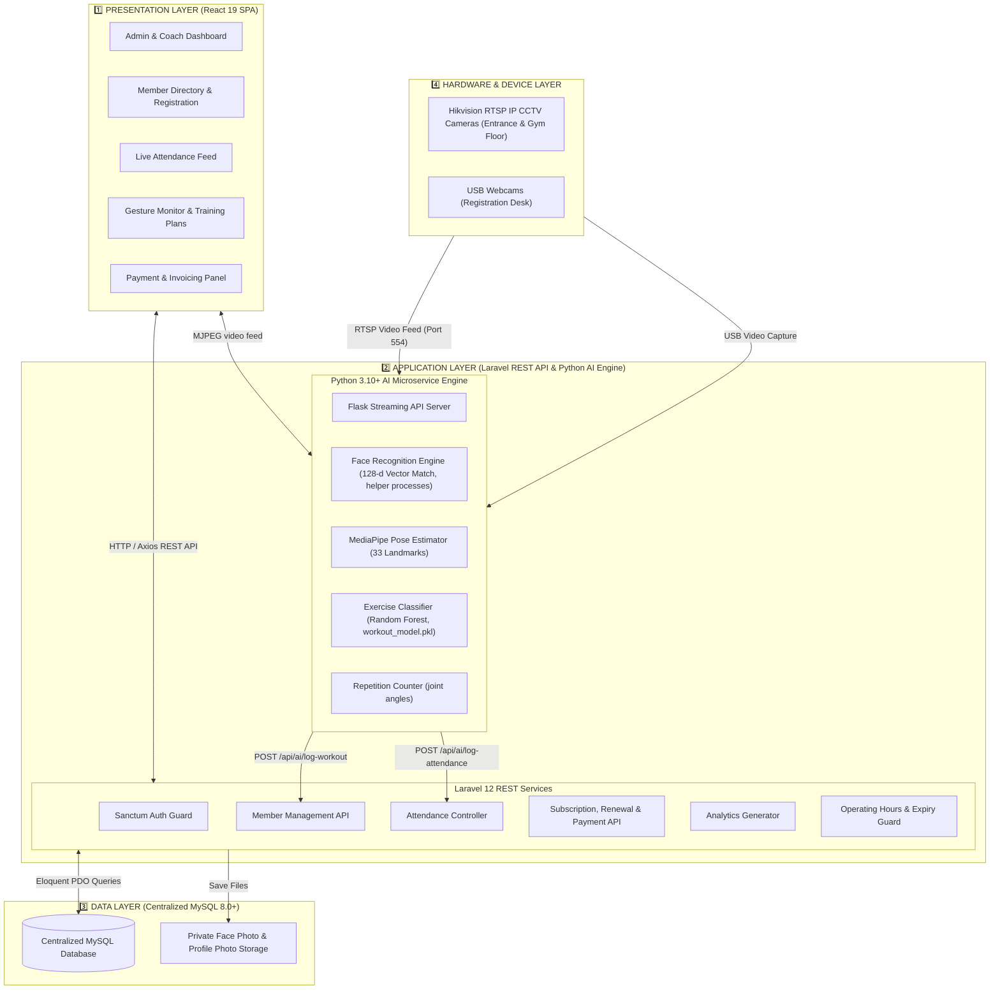
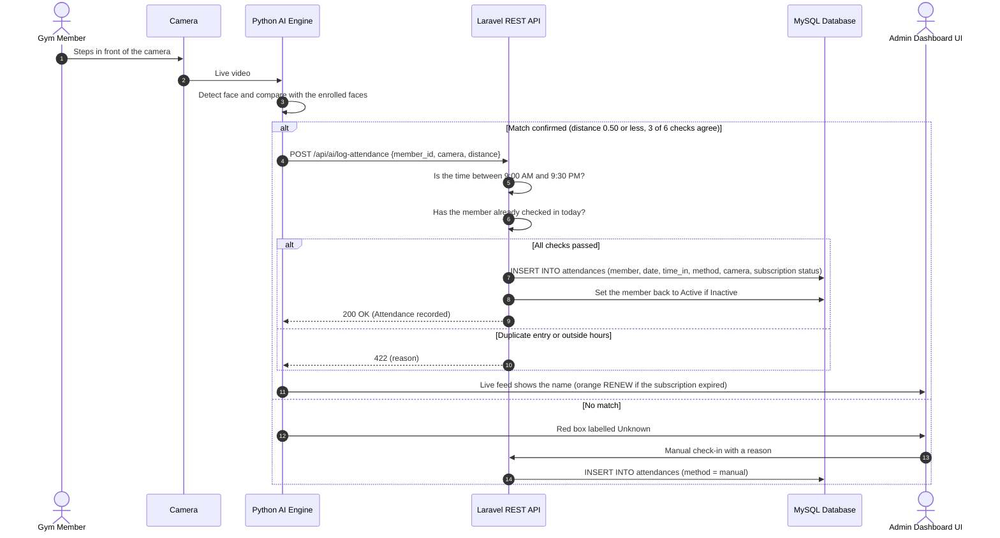
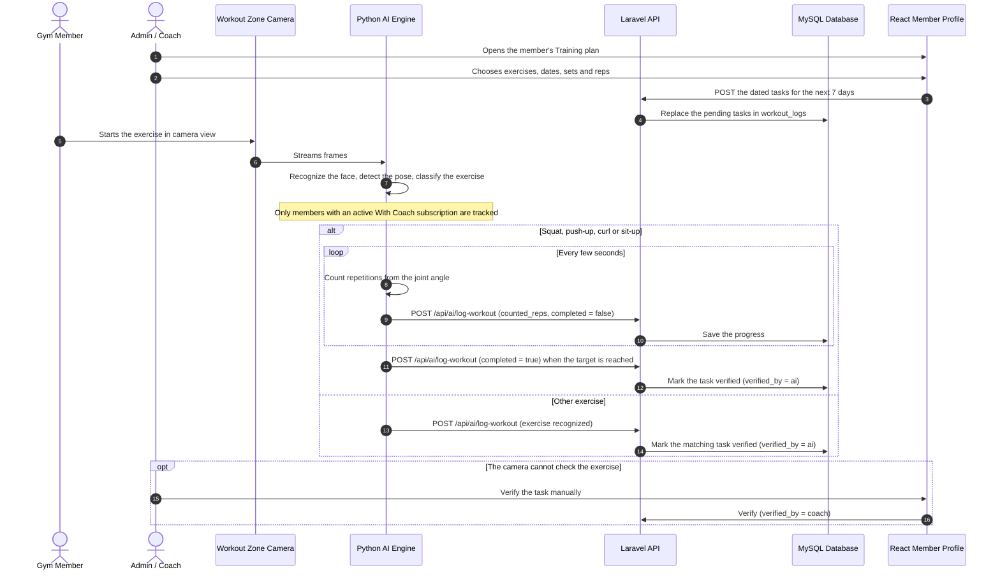

# System Diagrams & Visual Models Document

**Product Name:** Camera-Based Gym Management System with Facial Recognition Attendance and Gesture-Based Program Monitoring  
**Client:** Muscle Bros Gym (Natumolan, Tagoloan, Misamis Oriental)  
**Document Version:** 2.0  
**Date:** November 17, 2026  
**Describes:** the system as built on this date.  

---

## 1. Executive Summary

This document provides a comprehensive visual and structural modeling specification for the **Camera-Based Gym Management System with Facial Recognition Attendance and Gesture-Based Program Monitoring** at Muscle Bros Gym. 

It encompasses all standard software engineering diagrams required for technical analysis, system design, capstone defense, and architecture validation:
1. **Input-Process-Output (IPO) Conceptual Model**
2. **System Context Diagram (Level 0 DFD)**
3. **Data Flow Diagram Level 1 (DFD Level 1)**
4. **Use Case Diagram (UCD) & Actor Specifications**
5. **System Architecture & Hardware Topology Diagram**
6. **Operational Sequence Diagrams** (Biometric Check-In, Gesture Verification, Payment Processing)

---

## 2. Input-Process-Output (IPO) Model

The Input-Process-Output (IPO) model illustrates the high-level operational data flow of the proposed system from initial data capture to final generated output reports.

```mermaid
flowchart LR
    subgraph INPUT ["📥 INPUT PHASE"]
        direction TB
        I1["Member Personal Data\n(Name, Contact, Address)"]
        I2["Anthropometric & Body Metrics\n(Height, Weight, Date of Birth)"]
        I3["Biometric Facial Enrollment\n(Face Vector Encodings)"]
        I4["Program Assignments\n(Exercise Types & Rep Targets)"]
        I5["Payment Transaction Info\n(Amount, Method: Cash/GCash/Maya)"]
        I6["Live Video Streams\n(RTSP CCTV / USB Webcams)"]
    end

    subgraph PROCESS ["⚙️ PROCESS PHASE"]
        direction TB
        P1["Member Registration & Profile Creation"]
        P2["Touchless Facial Recognition Attendance Check-In"]
        P3["MediaPipe Pose Tracking & Exercise Classification"]
        P4["Subscription Expiration & Status Auditor"]
        P5["Payment Transaction Invoicing & Billing Log"]
        P6["Executive Analytics & Report Aggregation"]
    end

    subgraph OUTPUT ["📤 OUTPUT PHASE"]
        direction TB
        O1["Enrolled Member Profiles & Badges"]
        O2["Daily Attendance Logs & Timestamps"]
        O3["AI-Verified Workout & Rep Reports"]
        O4["Automated Subscription Renewal Alerts"]
        O5["Digital Payment Receipts & Financial Ledger"]
        O6["Executive Dashboard Analytics & Exported Reports"]
    end

    INPUT --> PROCESS --> OUTPUT
```

---

## 3. System Context Diagram (Level 0 DFD)

The Context Diagram defines the system boundary, showcasing external entities interacting with the central **Camera-Based Gym Management System**.

---

## 4. Data Flow Diagram Level 1 (DFD Level 1)

DFD Level 1 decomposes the main system into eight processes and maps how data moves between external entities, processes, and the data stores (database tables and the private face-photo files).

```mermaid
flowchart LR
    Admin["Gym Owner / Admin"]
    Camera["Camera"]
    Mail["Email Server"]
    P1(["1.0<br/>Log In"])
    P2(["2.0<br/>View Dashboard"])
    P3(["3.0<br/>Manage Members"])
    P4(["4.0<br/>Attendance Monitoring"])
    P5(["5.0<br/>Program Monitoring"])
    P6(["6.0<br/>Packages and Subscriptions"])
    P7(["7.0<br/>Payment Transactions"])
    P8(["8.0<br/>Reports"])

    Admin -->|"Email, password; forgot-password request, PIN and new password"| P1
    P1 -->|"Login result, session token"| Admin
    S10[("D1 admins")]
    P1 <-->|"Admin account"| S10
    S12[("D9 personal_access_tokens")]
    P1 -->|"Session token"| S12
    S13[("D11 password_reset_pins")]
    P1 <-->|"Password-reset PIN"| S13
    P1 -->|"Password-reset PIN"| Mail

    Admin -->|"Dashboard request"| P2
    P2 -->|"Totals, sales chart, notifications"| Admin
    S20[("D2 members")]
    P2 ~~~ S20
    S20 -->|"Member count"| P2
    S21[("D7 memberships")]
    P2 ~~~ S21
    S21 -->|"Active and expiring subscriptions"| P2
    S22[("D8 transactions")]
    P2 ~~~ S22
    S22 -->|"Revenue"| P2
    S23[("D4 attendances")]
    P2 ~~~ S23
    S23 -->|"Today's check-ins"| P2
    S24[("D10 coach_events")]
    P2 ~~~ S24
    S24 -->|"Classes and events this week"| P2

    Admin -->|"Member details, body type, face capture, consent, member status"| P3
    P3 -->|"Member list and profiles"| Admin
    S30[("D2 members")]
    P3 <-->|"Member records"| S30
    S31[("D3 face photo files")]
    P3 -->|"Face photo"| S31

    Admin -->|"Camera selection, manual check-in"| P4
    P4 -->|"Live feed, today's check-ins"| Admin
    S40[("D2 members")]
    P4 ~~~ S40
    S40 -->|"Enrolled members"| P4
    P4 -->|"Returning member set back to Active"| S40
    S41[("D3 face photo files")]
    P4 ~~~ S41
    S41 -->|"Face photos"| P4
    S42[("D4 attendances")]
    P4 <-->|"Member, date, time in, method, camera, subscription status"| S42
    S43[("D7 memberships")]
    P4 ~~~ S43
    S43 -->|"Subscription on the check-in date"| P4

    Admin -->|"7-day training plan, manual verification"| P5
    P5 -->|"Task status, counted repetitions, workout history"| Admin
    S50[("D5 workout_logs")]
    P5 <-->|"Assigned tasks, counted repetitions, verified tasks"| S50
    S51[("D7 memberships")]
    P5 ~~~ S51
    S51 -->|"Active With Coach subscription"| P5

    Admin -->|"Packages, subscriptions, renewals, upgrades, classes and events"| P6
    P6 -->|"Package list, subscription status"| Admin
    S60[("D6 plans")]
    P6 <-->|"Packages"| S60
    S61[("D7 memberships")]
    P6 <-->|"Subscriptions"| S61
    S62[("D8 transactions")]
    P6 -->|"Automatic payment record"| S62
    S63[("D10 coach_events")]
    P6 <-->|"Classes and events"| S63

    Admin -->|"Payment details, refund request"| P7
    P7 -->|"Transaction list, receipt"| Admin
    S70[("D8 transactions")]
    P7 <-->|"Transactions"| S70
    S71[("D6 plans")]
    P7 ~~~ S71
    S71 -->|"Package name"| P7

    Admin -->|"Report type, date range"| P8
    P8 -->|"Report table, CSV or print"| Admin
    S80[("D8 transactions")]
    P8 ~~~ S80
    S80 -->|"Payments"| P8
    S81[("D7 memberships")]
    P8 ~~~ S81
    S81 -->|"Subscriptions"| P8
    S82[("D4 attendances")]
    P8 ~~~ S82
    S82 -->|"Check-ins"| P8
    S83[("D5 workout_logs")]
    P8 ~~~ S83
    S83 -->|"Workout tasks and counted repetitions"| P8

    Camera -->|"Live video"| P4
    Camera -->|"Live video"| P5
```

---

## 5. Use Case Diagram (UCD) & Actor Specifications

The Use Case Diagram highlights all functional interactions provided by the system, categorized by user roles and automated AI camera actors.

### Actor Description Matrix

| Actor | Type | Description & System Responsibilities |
| :--- | :--- | :--- |
| **Gym Owner / Admin** | Primary Human Actor | Full system access through one shared login: members, packages and subscriptions, payments, reports, training plans, manual verification and manual check-in, and the live camera feeds. The gym owner and the coach use this same account. |
| **Gym Member** | External Human Participant | Never logs in. Gives personal details and consent, poses for face enrollment, faces the camera for attendance, and performs assigned exercises. |
| **Gesture Engine (camera)** | Automated Hardware/Software Actor | Reads the video feed, matches faces, extracts MediaPipe pose landmarks, classifies the exercise, counts repetitions for squat, push-up, curl and sit-up, and reports to Laravel. |

---

## 6. System Architecture & Topology Model

---

## 7. Operational Sequence Diagrams

### 7.1. Touchless Facial Recognition Attendance Check-In Sequence

---

### 7.2. Gesture Workout Verification Sequence

---

## 8. Diagram Summary Reference Matrix

| Diagram Type | Primary Purpose | Key Components & Standards |
| :--- | :--- | :--- |
| **IPO Model** | Conceptual System Flow | Categorizes System Inputs, Core Processes, and Generated Outputs |
| **Context Diagram (DFD L0)** | System Boundary & Entities | Defines high-level interaction between Admin, Member, Camera, Email Server & System |
| **DFD Level 1** | Process & Data Store Mapping | Decomposes the system into 8 processes interacting with 11 data stores (10 tables and the private face photo files) |
| **Use Case Diagram (UCD)** | Functional User Roles | Maps the use cases across 3 actors (Admin, Member, Camera / Gesture Engine); the detailed diagrams are in Section 4.2-D |
| **System Architecture** | Technical Tier Composition | 4-Layer model (Presentation, Application REST/AI, Data Layer, Hardware Layer) |
| **Sequence Diagrams** | Step-by-Step Runtime Logic | Detail execution sequences for touchless check-in (with manual check-in) and gesture repetition counting |
