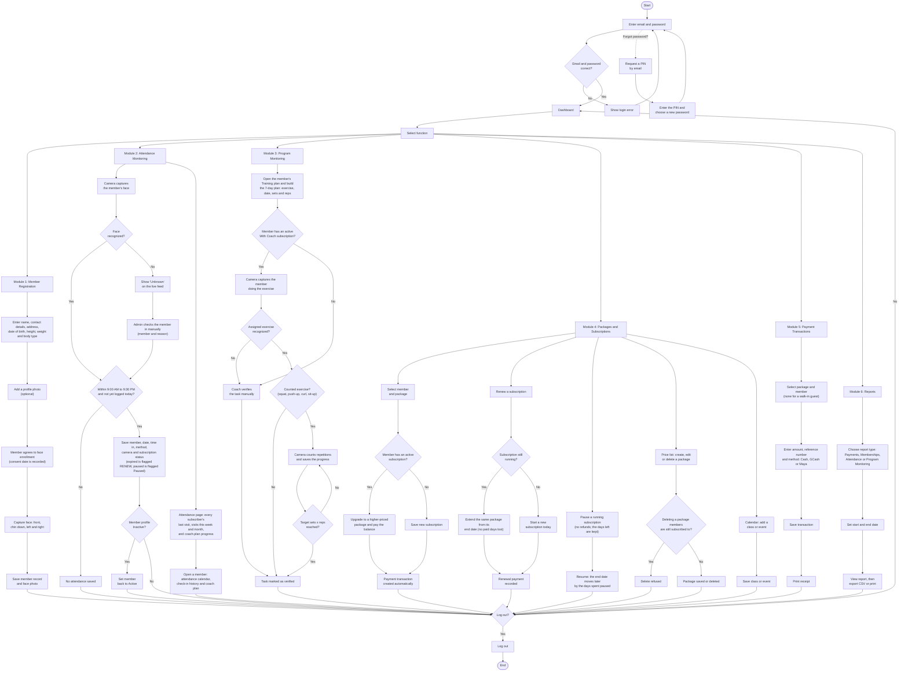

# 4.2-A System Process Flow Diagram

This section presents the System Process Flow Diagram for the **IoT-Based Gym Management System with Facial Recognition Attendance and Gesture-Based Program Monitoring for Muscle Bros Gym**. The diagram was developed from the requirements gathering phase (interview with the gym owner, observation of the gym and its paper records) and updated to match the system as built.

It shows the flow the Administrator (Gym Owner / Coach) follows from login to logout, the six modules, and the decisions the system makes.

> **Updated November 17, 2026** to match the system as built. The diagram is the same one as in `Updated Current Plan For Development/Chapter4_Diagrams (2).md`.

---

## 1. System Process Flow Diagram (Mermaid Render)

**Figure 4.3.** System Process Flow Diagram for the Administrator.

---

## 2. Process Narrative (Chapter 4 Standard)

### A. Narrative Walkthrough (EXPLAIN)
The flow begins when the administrator opens the system and enters an **email and password**. If they are not correct, an error is shown and the administrator tries again. A forgotten password is recovered by asking for a **PIN sent by email** and choosing a new password. There is no verification code at login. After a correct login the administrator reaches the Dashboard.

From the dashboard the administrator can open six modules:

1. **Member Registration.** The administrator enters name, contact details, address, date of birth, height, weight and **body type** (Ectomorph, Mesomorph or Endomorph), optionally adds a profile photo, records that the member **agrees to face enrollment** (the date of consent is saved), and captures the face in four views (front, chin down, left and right). The member record and face photo are then saved.
2. **Attendance Monitoring.** The camera captures the member's face and the system looks for a match. A recognized member is checked in only inside gym hours (9:00 AM to 9:30 PM) and once per day. The check-in saves the time, how it was made, the camera and the subscription status; an expired subscription is flagged **RENEW** on the live feed, and an Inactive member is set back to Active. A face that is not recognized shows "Unknown", and the administrator can **check the member in manually** by choosing the member and typing a reason.
3. **Program Monitoring.** In the member's **Training plan** the administrator builds a 7-day plan (exercise, date, sets, reps). Only members with an **active With Coach subscription** are tracked by the camera; for others the coach verifies tasks by hand. When the camera recognizes the assigned exercise, a task is verified. For **squat, push-up, curl and sit-up** the camera first **counts repetitions** and saves the progress until the target sets × reps is reached.
4. **Packages and Subscriptions.** The administrator subscribes a member to a package, or upgrades a running subscription to a higher-priced package and pays the balance. **Renew** extends a running subscription from its end date, or starts a new one today if it has ended. The **Price list** creates, edits and deletes packages; deleting a package that members are subscribed to is refused. The **Calendar** holds classes and events. Every subscription, renewal or upgrade creates its payment record automatically.
5. **Payment Transactions.** The administrator records a payment (package, member or walk-in guest, amount, reference number, Cash, GCash or Maya), and prints the receipt. Payments are never refunded.
6. **Reports.** The administrator chooses Payments, Memberships, Attendance or Program Monitoring, sets the dates, views the report, and exports a CSV file or prints it.

After any activity the administrator may return to the dashboard or log out.

### B. Meaning and Operational Impact (INTERPRET)
Manual sign-in sheets, watching members count repetitions, checking renewal dates by hand and paper receipts are replaced by automatic checks. Each decision in the flow (login check, face match, gym hours and one check-in per day, With Coach eligibility, target repetitions reached, package in use) protects the data before a record is saved.

### C. Alignment with Study Objectives (CONNECT)
The flow supports the objectives in Chapter 1: touchless **biometric attendance**, **computer-vision-assisted program monitoring** with repetition counting for selected exercises, **automatic subscription and renewal tracking**, and **payment recording** in Cash, GCash and Maya linked to subscriptions.

---

## 3. Changes Made on November 17, 2026 (Audit Trail)

| # | Part | Before | Now |
|---|---|---|---|
| 1 | Login | Email and password, then a 6-digit PIN | Email and password only; "Forgot password?" recovers by emailed PIN |
| 2 | Module 1 | Body type and face capture | Adds address, profile photo, face consent (date recorded) |
| 3 | Module 2 | Face match only | Adds manual check-in with a reason, the RENEW flag, and the check-in details saved |
| 4 | Module 3 | Select a member, assign an exercise, camera | Training plan for 7 days; only With Coach members are tracked; repetition counting until the target is reached; coach verifies by hand otherwise |
| 5 | Module 4 | Check status, renew | Subscribe, upgrade, **Renew**, Price list with delete guard, classes and events calendar |
| 6 | Module 6 | Two report types | Four: Payments, Memberships, Attendance, Program Monitoring |
