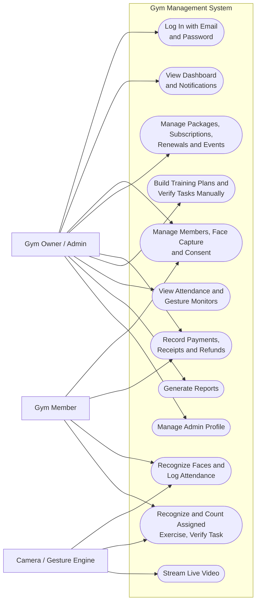
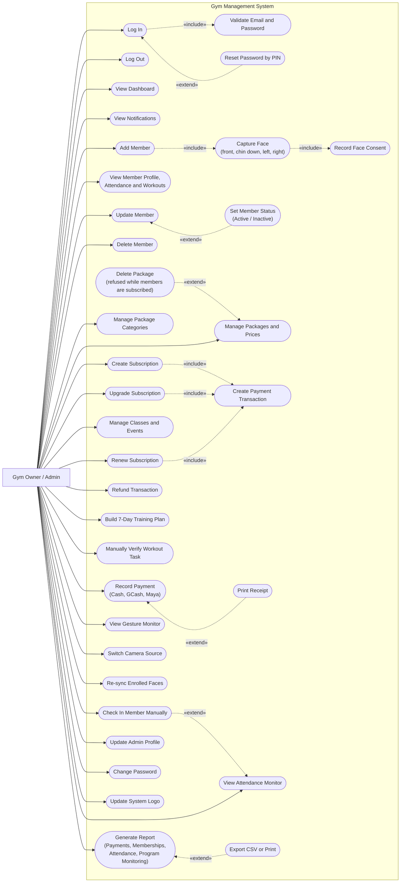
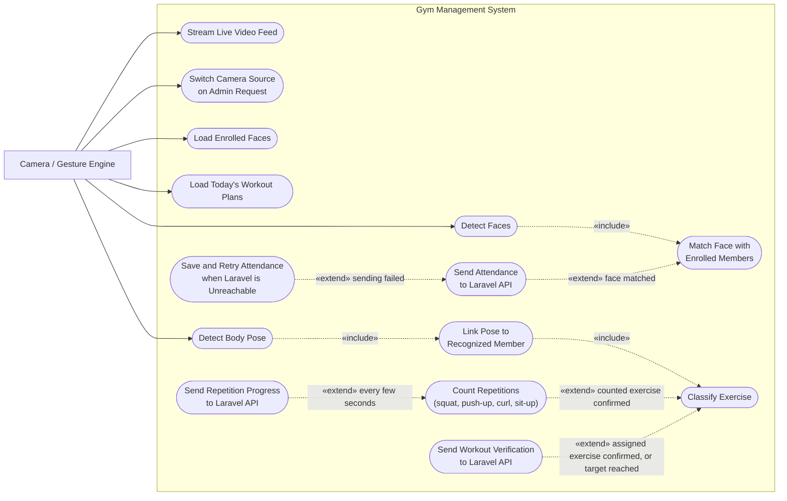
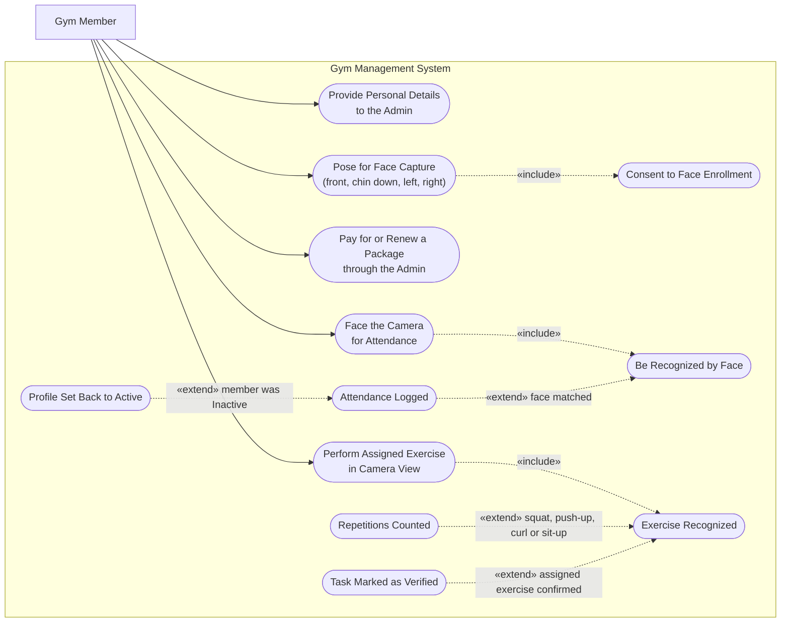

# System Use Case Specification
**Project Title:** Design and Development of an IoT-Based Gym Management System with Facial Recognition Attendance and Gesture-Based Program Monitoring for Double Alpha Fitness Gym
**Document Version:** 3.0 (updated November 17, 2026 to match the system as built)

The diagrams in sections 3, 4 and 5 are the same as Figures 4.6, 4.8 and 4.7 in `Updated Current Plan For Development/Chapter4_Diagrams (2).md`.

---

## 1. System Overview — Combined Use Case Diagram

This diagram shows the system boundary with the three actors and their use cases.

---

## 2. System Actors and Roles

| Actor Name | Type | Description |
|---|---|---|
| **Gym Owner / Coach (Admin)** | **Primary System Actor** | The owner and the coach share one administrator login. They use the web system to manage members, packages, payments, training plans, cameras and reports. |
| **Camera / Gesture Engine** | **IoT / Device Actor** | The camera (RTSP CCTV, phone camera or USB webcam) and the Python engine that recognizes faces, tracks body pose, counts repetitions and streams video. |
| **Gym Member** | **Participating Actor (Physical)** | A registered member who takes part in person: face capture, the entrance camera and exercises in front of the gesture camera. Members do not log in. |

---

## 3. Actor 1 — Gym Owner / Coach (Admin)

### 3.1 Use Case Diagram

### 3.2 Use Case Relationships and Scope Boundaries

#### A. Narrative Explanation of Relationships

1. **Include relationships (`<<include>>`), mandatory sub-processes:**
   * **Log In includes Validate Email and Password:** the password is checked against the stored bcrypt hash. There is no verification code.
   * **Add Member includes Capture Face**, which includes **Record Face Consent:** a face is never saved without the member's consent; the server refuses it and records the date and time of consent.
   * **Create Subscription, Upgrade Subscription and Renew Subscription include Create Payment Transaction:** each of them saves its payment record automatically.
2. **Extend relationships (`<<extend>>`), optional behaviors:**
   * **Reset Password by PIN extends Log In:** only when the administrator chooses "Forgot password?". A 6-digit PIN is emailed to the administrator email, valid for 10 minutes with 5 attempts.
   * **Set Member Status extends Update Member:** the admin may set a member Active or Inactive by hand.
   * **Delete Package extends Manage Packages and Prices:** it is refused while members are subscribed to the package.
   * **Print Receipt extends Record Payment:** only when a receipt is wanted.
   * **Check In Member Manually extends View Attendance Monitor:** used when the camera cannot recognize a member.
   * **Export CSV or Print extends Generate Report.**
3. **System exclusions, features out of scope (per the approved scope):**
   * **No payment gateway:** payments are only recorded (Cash, GCash, Maya); no card processing.
   * **No native mobile application:** the system is a responsive web application.
   * **No medical diagnosis:** height, weight and body type are reference data for the coach.
   * **No multi-factor authentication:** login is email and password only.
   * **No automatic billing:** renewals are made at the desk.

---

### 3.3 Admin Use Case Summary

| Use Case ID | Use Case Name | Description |
|:---:|---|---|
| **UC-01** | Authentication | Signs in with email and password and opens a session; recovers a forgotten password by emailed PIN. |
| **UC-02** | View Dashboard & Notifications | Shows today's check-ins, expiring subscriptions, payments, income, classes and events, and alerts. |
| **UC-03** | Member Registration & Face Enrollment | Creates members with body measurements and body type, and enrolls the face with recorded consent. |
| **UC-04** | Packages, Subscriptions, Renewals & Events | Manages packages and prices, subscribes, upgrades and renews members, and keeps the classes and events calendar. |
| **UC-05** | Payment Transaction Recording | Records Cash, GCash and Maya payments, refunds and printable receipts. |
| **UC-06** | Attendance Monitoring | Views the live feed and today's check-ins, makes manual check-ins, and re-syncs faces. |
| **UC-07** | Training Plan & Task Verification | Builds a 7-day plan per member and verifies tasks the camera cannot check. |
| **UC-09** | Camera Stream & Hardware Control | Views live feeds and switches the camera source. |
| **UC-10** | Reports | Filters and exports Payments, Memberships, Attendance and Program Monitoring reports. |
| **UC-11** | Admin Profile & Security | Updates name, email, system logo and password. |

### 3.4 Admin Formal Use Case Specifications

---

#### **UC-01: Authentication**
* **Primary Actor:** Gym Owner / Coach (Admin)
* **Preconditions:** An administrator account exists.
* **Main Flow:**
  1. The admin opens the system and sees the Login screen.
  2. The admin enters email and password (optionally ticks Remember me) and presses Login.
  3. The system checks them (`POST /api/auth/login`) and creates a Sanctum token, kept in the browser (local storage if Remember me, otherwise session storage).
  4. The system saves a note of the sign-in (device type and time) for the notification bell.
  5. The admin is taken to the Overview.
* **Alternative Flows:**
  * *3a. Wrong email or password:* "Invalid email or password" is shown; nothing is created. Login is limited to 10 attempts per minute.
  * *3b. Forgot password:* the admin enters the email and presses "Forgot password?". The system emails a 6-digit PIN (10 minutes, 5 attempts). The admin enters the PIN and a new password of at least 8 characters.
  * *5a. Log out:* `POST /api/auth/logout` deletes the token.
* **Postconditions:** The admin has access to all modules.

---

#### **UC-02: View Dashboard & Notifications**
* **Primary Actor:** Gym Owner / Coach
* **Preconditions:** The admin is logged in.
* **Main Flow:**
  1. The Overview loads `GET /api/dashboard`: today's check-ins and a chart per hour, subscriptions ending this week, recent payments, new members, monthly income, and classes and events this week, with a calendar of subscriptions and events.
  2. The notification bell (`GET /api/notifications` and local data) lists subscriptions ending within 7 days, upcoming classes and events, and the last sign-in (marked as a new device when the device type changed).
  3. Opening the dashboard also runs the daily inactivity rule once per day.
* **Alternative Flows:** *1a. Numbers cannot be loaded:* an error with a Retry button is shown, with the last data kept.
* **Postconditions:** The admin sees the current state of the gym.

---

#### **UC-03: Member Registration & Face Enrollment**
* **Primary Actor:** Gym Owner / Coach
* **Participating Actor:** Gym Member
* **Preconditions:** The admin is logged in; a camera is available for the face capture.
* **Main Flow:**
  1. The admin presses "Register a member".
  2. **Photos:** the admin adds an optional profile photo (cropped) and captures the face in four views (front, chin down, slight left, slight right), then ticks the member's consent.
  3. **Personal details:** name, email, phone, address.
  4. **Body measurements (optional):** date of birth, height, weight (the BMI is worked out) and body type (Ectomorph, Mesomorph or Endomorph).
  5. The admin saves (`POST /api/members`). The server stores the record, saves the face as a private image file and records the date of consent.
  6. The engine notices the new member within a minute (it compares its list with `GET /api/ai/members-faces` every minute) and starts recognizing them; "Force AI Memory Sync" does it at once.
* **Alternative Flows:**
  * *5a. Face captured but consent not ticked:* saving is blocked with "Consent Required".
  * *5b. Duplicate email or missing required field:* the server refuses and says which field.
  * *5c. No face found in any view by the engine:* the member is saved but is not recognized until the face is captured again.
* **Postconditions:** The member exists (Active) and can be recognized by the camera.

---

#### **UC-04: Packages, Subscriptions, Renewals & Events**
* **Primary Actor:** Gym Owner / Coach
* **Preconditions:** The admin is logged in.
* **Main Flow (subscribe):**
  1. On **Packages > Subscriptions** the admin presses "Subscribe a member" and chooses the member, the package, the payment method and (optionally) a reference number.
  2. The system works out the end date and the amount (a loyalty discount of ₱20 per earlier subscription applies above ₱300, never below ₱300) and shows a summary.
  3. `POST /api/memberships` saves the subscription, sets the member Active, and creates the payment transaction automatically.
* **Main Flow (renew):** the admin presses **Renew** on a subscription. A dialog shows the new dates and the amount. `POST /api/memberships/{id}/renew` extends a running subscription from its current end date, or starts a new subscription today if it has ended, and records the payment.
* **Main Flow (upgrade):** the admin edits a running subscription to a higher-priced package; only the remaining balance is charged and the period restarts.
* **Main Flow (price list):** on **Price list** the admin creates, edits or deletes packages (name, category Normal / With Coach / Walk-In, days, price, colour). `DELETE /api/plans/{id}` is refused while members are subscribed to the package.
* **Main Flow (calendar):** on **Calendar** the admin clicks an empty day to add a class or event, or edits or deletes one.
* **Alternative Flows:**
  * *1a. Member already has a running subscription:* a new one is refused ("Upgrade the existing subscription instead").
  * *Renew a deleted package:* the admin must choose a package.
  * *Renew a running subscription with another package:* refused; use Edit to upgrade.
* **Postconditions:** The subscription and its payment are saved.

---

#### **UC-05: Payment Transaction Recording**
* **Primary Actor:** Gym Owner / Coach
* **Participating Actor:** Gym Member
* **Preconditions:** The admin is logged in.
* **Main Flow:**
  1. On **Transactions** the admin presses "Record a payment".
  2. The admin chooses the package, the member (or none for a walk-in guest), the amount, the payment method (Cash, GCash, Maya) and a reference number.
  3. `POST /api/transactions` saves it with a receipt code such as TXN-001.
  4. The admin may print the receipt, edit or delete the transaction, or refund it (`POST /api/transactions/{id}/refund`: a negative entry is added and the original is marked Refunded).
* **Alternative Flows:** *3a. Missing required field:* the form refuses to save. Rapid double clicks do not save twice.
* **Postconditions:** The payment is in the ledger and in the reports.

---

#### **UC-06: Attendance Monitoring**
* **Primary Actor:** Gym Owner / Coach
* **Secondary Actor:** Camera / Gesture Engine
* **Preconditions:** The Python engine is running (port 5000).
* **Main Flow:**
  1. The admin opens **Attendance Monitor**. The live feed shows each recognized member's name and an "Unknown" tag for others; an expired subscription shows an orange box and "RENEW".
  2. Today's check-ins (`GET /api/attendance/today`) are listed with badges (Active, Expired, No Sub, Returned, Manual).
  3. For a member the camera cannot recognize, the admin presses the manual check-in button, chooses the member and types a reason (`POST /api/attendance/manual`). The same rules apply as for the camera.
  4. "Force AI Memory Sync" reloads the enrolled faces; "Full Log" opens the Attendance report.
* **Alternative Flows:** *3a. Outside gym hours:* refused. *3b. Already checked in today:* refused.
* **Postconditions:** The check-in is saved with its method, camera and subscription status.

---

#### **UC-07: Training Plan & Task Verification**
* **Primary Actor:** Gym Owner / Coach
* **Preconditions:** The admin is logged in; the member exists.
* **Main Flow:**
  1. The admin opens the **Training plan** from Packages (With Coach rows), Member Registration or the member profile tab.
  2. The admin adds exercises to each day (the list can show only exercises the camera can check) and sets sets and reps per set; a day can be copied to other days.
  3. The admin presses "Save plan" (`POST /api/members/{id}/workout-plan`): tasks are saved for the next 7 days.
  4. The camera verifies tasks for members with an active With Coach subscription (UC-08).
  5. A task the camera cannot check is confirmed by the admin: profile > Workout Logs > open the day > **VERIFY** (`PUT /api/workouts/{id}/manual-verify`). The log records "by coach".
* **Alternative Flows:**
  * *1a. Member not on an active With Coach package:* a note says the camera will not track them; tasks need manual verification.
  * *5a. Member has not checked in today:* VERIFY is locked.
  * *Closing with unsaved changes:* the admin is asked first.
* **Postconditions:** Tasks are scheduled or verified, with who verified them and when.

---

#### **UC-09: Camera Stream & Hardware Control**
* **Primary Actor:** Gym Owner / Coach
* **Secondary Actor:** Camera / Gesture Engine
* **Preconditions:** The engine is running on port 5000.
* **Main Flow:**
  1. The admin opens **Attendance Monitor** or **Gesture Monitor**; the page shows the engine's live feed.
  2. The admin chooses a source (CCTV 1, 2, 3, phone camera or webcam). The page sends `POST /switch_camera` (with the admin's login token).
  3. The engine reconnects to the new source.
* **Alternative Flows:** *2a. Source not configured or unreachable:* the engine reports a connection problem and a placeholder frame is shown; it does not silently switch to another camera.
* **Postconditions:** The chosen camera is streaming.

---

#### **UC-10: Reports**
* **Primary Actor:** Gym Owner / Coach
* **Preconditions:** Records exist.
* **Main Flow:**
  1. The admin opens **Reports** and chooses **Payments**, **Memberships**, **Attendance** or **Program Monitoring**.
  2. The admin sets the dates (or picks Today, Last 7 days, This month) and may search the table (`GET /api/reports?start=&end=`).
  3. The admin presses **Export CSV** or **Print report**.
  * *Program Monitoring* lists each task with its target, the repetitions counted, its status (Pending, Missed, Verified, Detected) and who verified it.
* **Alternative Flows:** *2a. No records:* "No records in this period". *2b. Load failure:* an error with Retry.
* **Postconditions:** The report is shown, exported or printed.

---

#### **UC-11: Admin Profile & Security**
* **Primary Actor:** Gym Owner / Coach
* **Preconditions:** The admin is logged in.
* **Main Flow:**
  1. The admin opens the account page (`GET /api/admin/me`).
  2. The admin changes the name and email (`POST /api/admin/profile`), the system logo (`POST /api/admin/logo`, an image up to 5 MB) and the password (`POST /api/admin/password`).
* **Alternative Flows:** *2a. Wrong current password or mismatching new passwords:* the change is refused with a message.
* **Postconditions:** The account details are updated.

---

## 4. Actor 2 — Camera / Gesture Engine

### 4.1 Use Case Diagram

### 4.2 Use Case Relationships and Scope Boundaries

#### A. Narrative Explanation of Relationships

1. **Include relationships:** Detect Faces includes Match Face with Enrolled Members. Detect Body Pose includes Link Pose to Recognized Member, which includes Classify Exercise.
2. **Extend relationships (optional behaviors):**
   * Send Attendance extends Match: only when a face is matched (and confirmed by several agreeing checks).
   * Save and Retry Attendance extends Send Attendance: only when Laravel is unreachable; the check-in is kept in a file and re-sent every 30 seconds with its real time.
   * Count Repetitions extends Classify Exercise: only for squat, push-up, curl and sit-up once the assigned exercise is confirmed.
   * Send Repetition Progress extends Count Repetitions: every few seconds while a member works.
   * Send Workout Verification extends Classify Exercise: when the assigned exercise is confirmed (or, for counted exercises, when the target sets × reps is reached).
3. **System exclusions:**
   * **No posture or form correction:** the engine counts movements for selected exercises; it does not judge form or give safety advice.
   * **No wearable or equipment sensors:** optical camera input only.
   * **No continuous video recording:** frames are processed live and not archived.

---

### 4.3 Engine Use Case Summary

| Use Case ID | Use Case Name | Description |
|:---:|---|---|
| **UC-06** | Facial Recognition Attendance | Detects faces, matches them with enrolled members and sends the check-in to the backend. |
| **UC-08** | Gesture Monitoring & Repetition Counting | Detects pose, classifies the exercise, counts repetitions for selected exercises, and sends progress and verification. |
| **UC-09** | Camera Stream & Source Switching | Provides the live feeds and switches the camera source on request. |

### 4.4 Engine Formal Use Case Specifications

---

#### **UC-06: Facial Recognition Attendance**
* **Primary Actor:** Camera / Gesture Engine
* **Participating Actor:** Gym Member
* **Preconditions:** A camera is connected; faces are enrolled; the engine is running.
* **Main Flow:**
  1. The engine reads frames from the chosen camera (OpenCV).
  2. It detects faces and, for faces at least 40 pixels wide, encodes each face in a helper process (so the video does not freeze).
  3. It compares each encoding with the enrolled faces. A match needs a distance of at most 0.50 (0.45 for a small, far face) and a margin of at least 0.05 over the next closest member.
  4. A name is shown, and attendance sent, only when 3 of the last 6 checks agree (5 for a far face).
  5. The engine sends the member and the camera to `POST /api/ai/log-attendance` with its token.
  6. The backend saves the check-in if it is within gym hours and the member has not checked in today; the monitor shows it.
* **Alternative Flows:**
  * *3a. No match or an ambiguous match:* the face is shown as "Unknown" (or "Move closer" if too small); nothing is saved.
  * *6a. Laravel unreachable:* the check-in is saved to a file and re-sent every 30 seconds.
  * *6b. Optional blink check* (`LIVENESS_REQUIRED=true`): the member is checked in only after blinking, which stops a printed photo.
* **Postconditions:** The member's entry is recorded with the date and time.

---

#### **UC-08: Gesture Monitoring & Repetition Counting**
* **Primary Actor:** Camera / Gesture Engine
* **Participating Actor:** Gym Member
* **Supporting Actor:** Gym Owner / Coach
* **Preconditions:** The member is recognized and has an active With Coach subscription and a plan for today; the pose model and classifier are loaded.
* **Main Flow:**
  1. The member exercises in view of the camera; the engine detects body landmarks (MediaPipe pose) and links them to the recognized face.
  2. The classifier (`workout_model.pkl`) predicts the exercise from the landmarks. The assigned exercise is confirmed when at least 5 of the last 7 predictions agree with at least 70% confidence.
  3. For **squat, push-up, curl and sit-up** the engine measures the knee, elbow or hip angle and counts each full bend-and-straighten as one repetition. The overlay shows `SQUAT REPS: 7 / 30 (SET 1 OF 3)`.
  4. Every few seconds the engine sends the count (`POST /api/ai/log-workout` with `completed=false`); the count is kept per member, so leaving the picture does not reset it.
  5. When sets × reps is reached, the engine sends the final count and the backend marks the task verified by the camera. Other exercises are verified as soon as they are recognized.
* **Alternative Flows:**
  * *1a. Member not on a With Coach package:* only a grey tag "<name> - no coach plan" is shown.
  * *2a. Body not fully visible, not moving, or low confidence:* the screen says so and no task is verified.
  * *5a. Two tasks with the same camera class:* the engine does not guess; it shows "COACH VERIFY".
* **Postconditions:** The repetitions and the verification (by camera, with the time) are stored in `workout_logs`.

---

## 5. Actor 3 — Gym Member

### 5.1 Use Case Diagram

### 5.2 Use Case Relationships and Scope Boundaries

#### A. Narrative Explanation of Relationships

1. **Include relationships:** Pose for Face Capture includes Consent to Face Enrollment (a face is not saved without consent). Face the Camera includes Be Recognized by Face. Perform Assigned Exercise includes Exercise Recognized.
2. **Extend relationships:** Attendance Logged extends Be Recognized (only when a face is matched); Profile Set Back to Active extends Attendance Logged (only when the member was Inactive); Repetitions Counted extends Exercise Recognized (only for squat, push-up, curl and sit-up); Task Marked as Verified extends Exercise Recognized (when the assigned exercise is confirmed).
3. **System exclusions for members:** no web login, no mobile application and no online payment. Members are served by the camera and the admin.

---

### 5.3 Gym Member Use Case Summary

| Use Case ID | Use Case Name | Member Role |
|:---:|---|---|
| **UC-03** | Member Registration & Face Enrollment | Gives personal details, agrees to face enrollment and poses for the face capture. |
| **UC-05** | Payment (also renewal) | Pays Cash, GCash or Maya to the admin, who records it. |
| **UC-06** | Facial Recognition Attendance | Faces the camera; attendance is logged. |
| **UC-08** | Gesture-Monitored Exercise | Exercises in view of the camera; repetitions are counted for selected exercises. |

### 5.4 Gym Member Formal Use Case Specifications

> Members have no login. Their interactions are in person, at the camera or with the admin.

---

#### **UC-03 (Member Role): Registration & Face Enrollment**
* **Main Flow:**
  1. The member gives name, contact details and address, and (optionally) date of birth, height, weight and body type is assessed by the admin.
  2. The member agrees to face enrollment; the admin ticks the consent box.
  3. The member poses for four face views: front, chin down, slight left and slight right.
  4. The admin saves the member.
* **Alternative Flows:** *3a. A view is blurry or blocked:* the admin retakes it. *2a. The member does not consent:* no face is saved; attendance must then be recorded manually.
* **Postconditions:** The member is registered, and recognized once the face is enrolled.

---

#### **UC-05 (Member Role): Payment or Renewal**
* **Main Flow:**
  1. The member tells the admin which package to buy or renew.
  2. The member pays in Cash, or shows the GCash or Maya reference.
  3. The admin records the subscription or renewal and the payment; the receipt can be printed.
* **Alternative Flows:** *2a. Subscription still running:* a renewal extends it from its end date.
* **Postconditions:** The payment is recorded and the subscription is valid.

---

#### **UC-06 (Member Role): Facial Recognition Attendance**
* **Main Flow:**
  1. The member walks in and faces the camera.
  2. The engine recognizes the face after several agreeing checks.
  3. The attendance is saved with the date and time and appears on the Attendance Monitor.
* **Alternative Flows:** *2a. Not recognized:* "Unknown" is shown; the admin can make a manual check-in. *3a. Subscription expired:* the member is still checked in, and "RENEW" is shown to the admin. *3b. Already checked in today:* nothing new is saved.
* **Postconditions:** The entry is recorded; an Inactive member becomes Active.

---

#### **UC-08 (Member Role): Gesture-Monitored Exercise**
* **Preconditions:** The member has an active With Coach subscription and a plan for today.
* **Main Flow:**
  1. The admin tells the member the exercise to do.
  2. The member stands where the whole body is visible and exercises at a natural pace.
  3. For squat, push-up, curl or sit-up the repetitions are counted on the monitor; when the target sets × reps is reached the task is marked verified.
* **Alternative Flows:** *2a. Body not fully visible or too dark:* the monitor says so; the member repositions. *3a. The camera cannot check the exercise:* the coach verifies it by hand.
* **Postconditions:** The workout is recorded with the repetitions counted.
