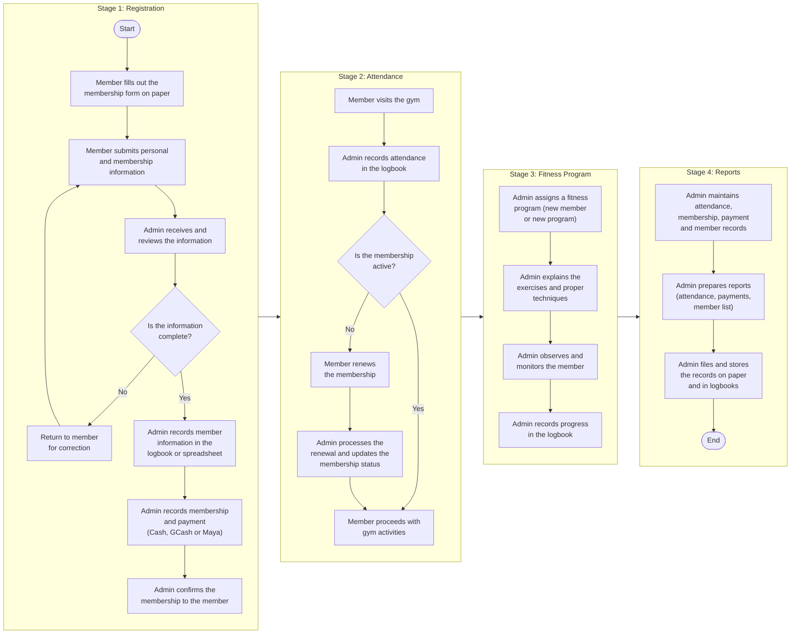
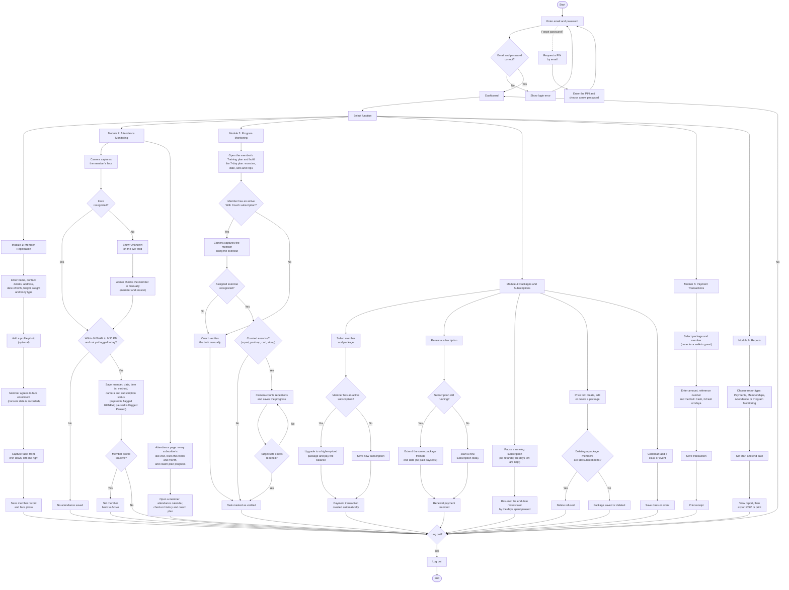
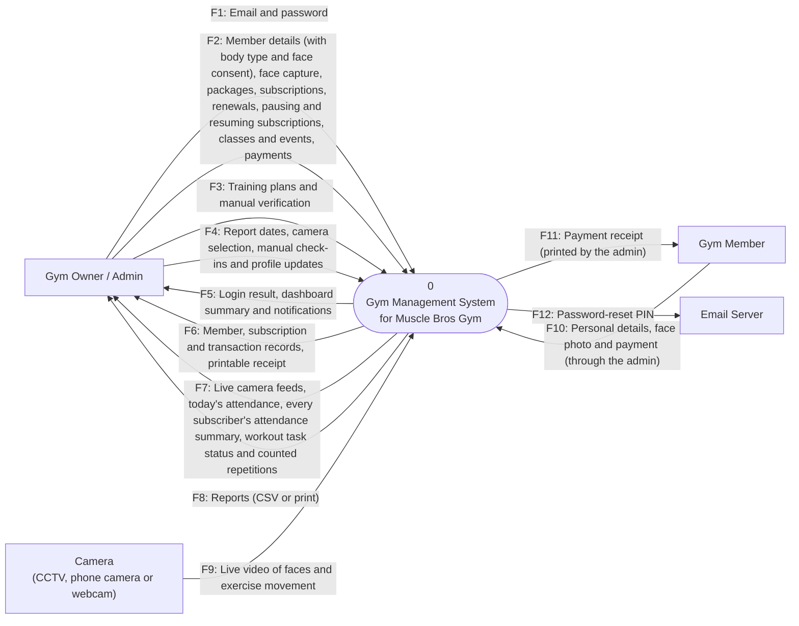
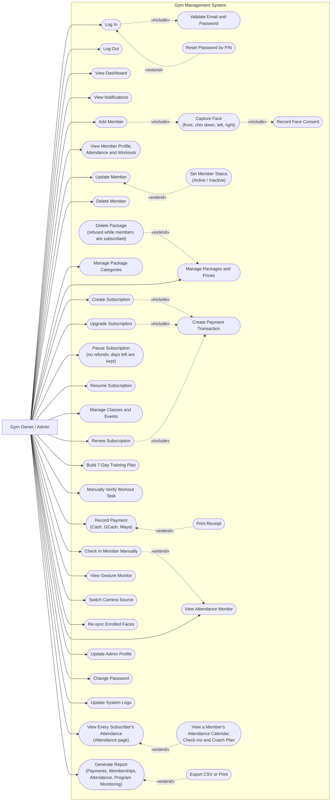
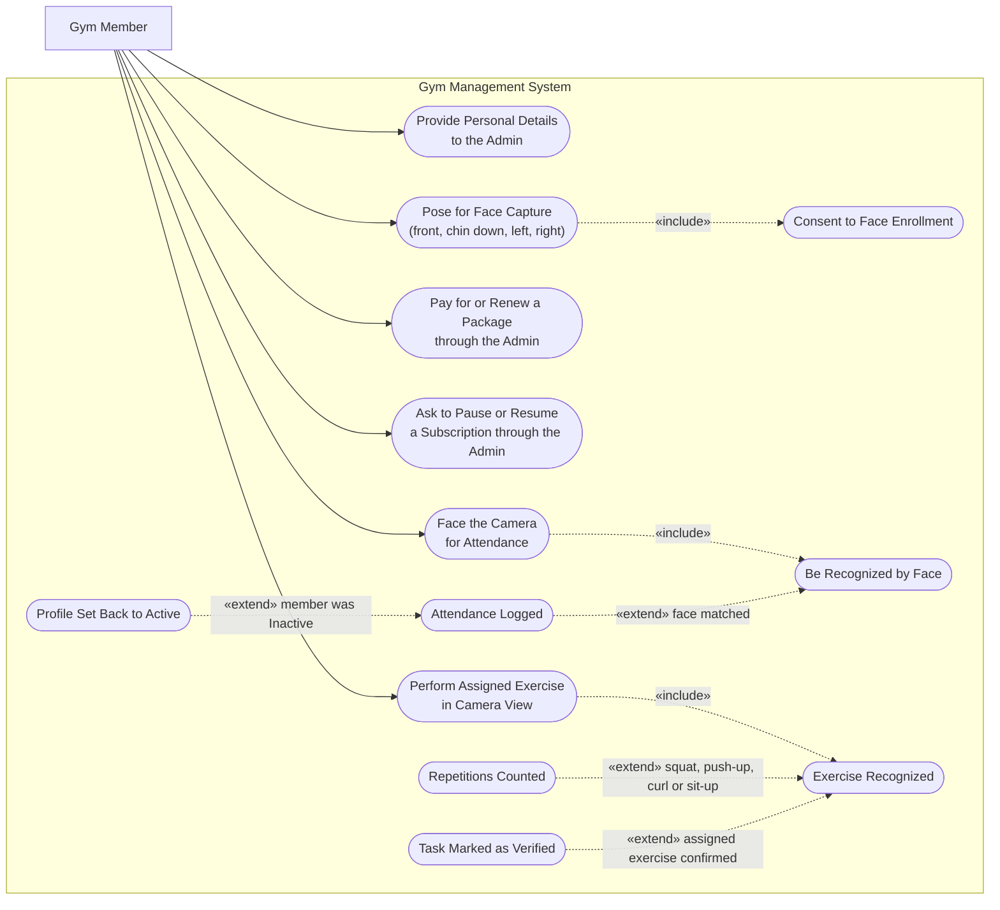
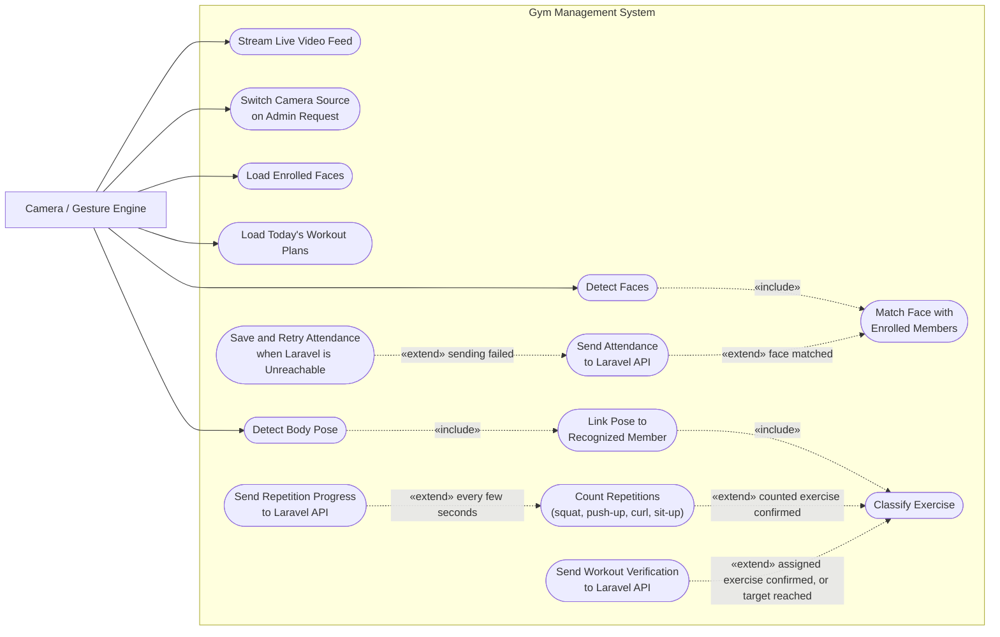
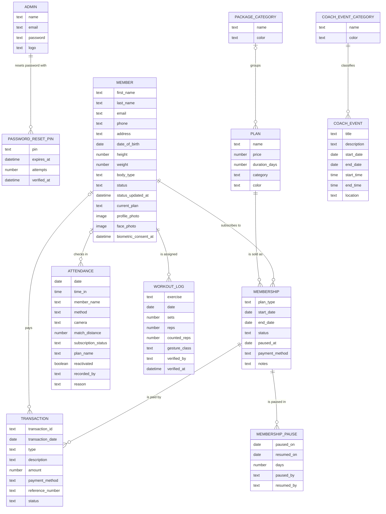
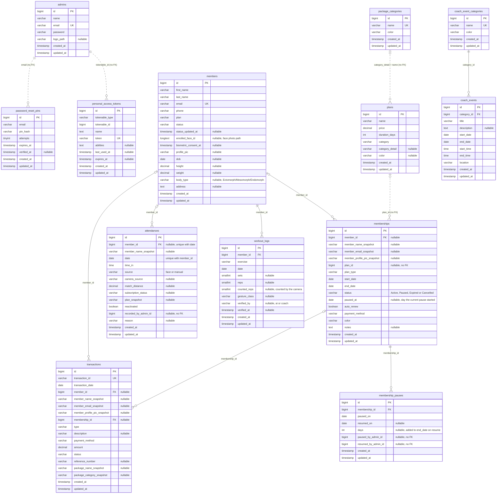

# Chapter 4 Diagrams — Muscle Bros Gym Management System

One diagram for each figure in Chapter 4. Figure 4.1 shows the gym's manual process before the system. Figures 4.3 to 4.10 are drawn from what the system actually does. Diagrams only.

| Figure | Diagram |
|---|---|
| 4.1 | Manual Process Flow for Admin |
| 4.3 | System Process Flow for Administrator |
| 4.4 | Context Level Diagram |
| 4.5 | Data Flow Diagram |
| 4.6 | Use Case Diagram for Gym Owner / Admin |
| 4.7 | Use Case Diagram for Gym Member |
| 4.8 | Use Case Diagram for Camera / Gesture Engine |
| 4.9 | Logical Entity-Relationship Diagram |
| 4.10 | Physical Entity-Relationship Diagram |

---

## Figure 4.1 — Manual Process Flow for Admin

---

## Figure 4.3 — System Process Flow for Administrator

---

## Figure 4.4 — Context Level Diagram

---

## Figure 4.5 — Data Flow Diagram

```mermaid
flowchart LR
    Admin["Gym Owner / Admin"]
    Camera["Camera"]
    Mail["Email Server"]
    P1(["1.0<br/>Log In"])
    P2(["2.0<br/>View Dashboard"])
    P3(["3.0<br/>Manage Members"])
    P4(["4.0<br/>Attendance Monitoring"])
    P5(["5.0<br/>Program Monitoring"])
    P6(["6.0<br/>Packages and Subscriptions"])
    P7(["7.0<br/>Payment Transactions"])
    P8(["8.0<br/>Reports"])

    Admin -->|"Email, password; forgot-password request, PIN and new password"| P1
    P1 -->|"Login result, session token"| Admin
    S10[("D1 admins")]
    P1 <-->|"Admin account"| S10
    S12[("D9 personal_access_tokens")]
    P1 -->|"Session token"| S12
    S13[("D11 password_reset_pins")]
    P1 <-->|"Password-reset PIN"| S13
    P1 -->|"Password-reset PIN"| Mail

    Admin -->|"Dashboard request"| P2
    P2 -->|"Totals, sales chart, notifications"| Admin
    S20[("D2 members")]
    P2 ~~~ S20
    S20 -->|"Member count"| P2
    S21[("D7 memberships")]
    P2 ~~~ S21
    S21 -->|"Active and expiring subscriptions"| P2
    S22[("D8 transactions")]
    P2 ~~~ S22
    S22 -->|"Revenue"| P2
    S23[("D4 attendances")]
    P2 ~~~ S23
    S23 -->|"Today's check-ins"| P2
    S24[("D10 coach_events")]
    P2 ~~~ S24
    S24 -->|"Classes and events this week"| P2

    Admin -->|"Member details, body type, face capture, consent, member status"| P3
    P3 -->|"Member list and profiles"| Admin
    S30[("D2 members")]
    P3 <-->|"Member records"| S30
    S31[("D3 face photo files")]
    P3 -->|"Face photo"| S31

    Admin -->|"Camera selection, manual check-in, attendance page filters"| P4
    P4 -->|"Live feed, today's check-ins, every subscriber's attendance"| Admin
    S40[("D2 members")]
    P4 ~~~ S40
    S40 -->|"Enrolled members"| P4
    P4 -->|"Returning member set back to Active"| S40
    S41[("D3 face photo files")]
    P4 ~~~ S41
    S41 -->|"Face photos"| P4
    S42[("D4 attendances")]
    P4 <-->|"Member, date, time in, method, camera, subscription status"| S42
    S43[("D7 memberships")]
    P4 ~~~ S43
    S43 -->|"Subscription on the check-in date, latest subscription per member"| P4
    S44[("D5 workout_logs")]
    P4 ~~~ S44
    S44 -->|"This week's coach tasks"| P4

    Admin -->|"7-day training plan, manual verification"| P5
    P5 -->|"Task status, counted repetitions, workout history"| Admin
    S50[("D5 workout_logs")]
    P5 <-->|"Assigned tasks, counted repetitions, verified tasks"| S50
    S51[("D7 memberships")]
    P5 ~~~ S51
    S51 -->|"Active With Coach subscription"| P5

    Admin -->|"Packages, subscriptions, renewals, upgrades, pause and resume, classes and events"| P6
    P6 -->|"Package list, subscription status"| Admin
    S60[("D6 plans")]
    P6 <-->|"Packages"| S60
    S61[("D7 memberships")]
    P6 <-->|"Subscriptions"| S61
    S62[("D8 transactions")]
    P6 -->|"Automatic payment record"| S62
    S63[("D10 coach_events")]
    P6 <-->|"Classes and events"| S63
    S64[("D12 membership_pauses")]
    P6 <-->|"Pause history"| S64

    Admin -->|"Payment details"| P7
    P7 -->|"Transaction list, receipt"| Admin
    S70[("D8 transactions")]
    P7 <-->|"Transactions"| S70
    S71[("D6 plans")]
    P7 ~~~ S71
    S71 -->|"Package name"| P7

    Admin -->|"Report type, date range"| P8
    P8 -->|"Report table, CSV or print"| Admin
    S80[("D8 transactions")]
    P8 ~~~ S80
    S80 -->|"Payments"| P8
    S81[("D7 memberships")]
    P8 ~~~ S81
    S81 -->|"Subscriptions"| P8
    S82[("D4 attendances")]
    P8 ~~~ S82
    S82 -->|"Check-ins"| P8
    S83[("D5 workout_logs")]
    P8 ~~~ S83
    S83 -->|"Workout tasks and counted repetitions"| P8

    Camera -->|"Live video"| P4
    Camera -->|"Live video"| P5
```

---

## Figure 4.6 — Use Case Diagram for Gym Owner / Admin

---

## Figure 4.7 — Use Case Diagram for Gym Member

---

## Figure 4.8 — Use Case Diagram for Camera / Gesture Engine

---

## Figure 4.9 — Logical Entity-Relationship Diagram

---

## Figure 4.10 — Physical Entity-Relationship Diagram

Decimal sizes: `members.height` and `members.weight` are DECIMAL(5,2), `plans.price` is DECIMAL(9,2), `transactions.amount` is DECIMAL(10,2), `attendances.match_distance` is DECIMAL(5,4).

Unique rule: `attendances` allows one row per (`member_id`, `date`), so a member has at most one check-in per day.

On delete: `workout_logs` and `membership_pauses` cascade; `attendances.member_id`, `memberships.member_id`, `transactions.member_id` and `transactions.membership_id` are set to null; `coach_events.category_id` is restricted.

Refunds are not offered: a subscription is paused instead (`memberships.status` = Paused, `memberships.paused_at`), and each pause is kept in `membership_pauses`; on resume the paused days are added to `end_date`.

`memberships.plan_id` has **no** foreign key in the database (checked on November 17, 2026); only `memberships.member_id` has one. The link to `plans` is kept by the application, which is why a package is not deleted while members are subscribed to it, and why an ended subscription keeps the package name in `plan_type`.

Not drawn because the application does not use them: `face_encodings`, `payments`, `exercise_sessions`, `gesture_logs`, `exercises`, `auth_verification_codes` (the old login PIN, removed), `users`, and Laravel's own tables (`sessions`, `cache`, `jobs` and similar).
